# ここだけ魔王の城ｺﾝﾏ99で勇者到来ｺﾝﾏ99でプログラミングスレ {#maou}
[takeshima.2ch.net/test/read.cgi/news4vip/1233393797/](https://kako.5ch.io/test/read.cgi/news4vip/1233393797/)
より抜粋


```
5 以下、名無しにかわりましてVIPがお送りします[] 2009/01/31(土) 19:07:07.44 ID:9NKa2DM90
魔王「側近よ、わしは本当は勇者に負けるのが定めなのではあるまいか？」
側近「いかがなされました、魔王様」
魔王「わしには見えるのだ。再び何者かが、光から現れよう」
側近「その言い回しはおやめ下さい、版権に関わります」
魔王「ふむ…。まあ、わしの言いたいのはこうだ：
　『呪文連打も試してみたけど　リセット相手じゃ意味がない』
　いくら勇者を倒したところで、これではわし勝機などないではないか！」
側近「左様でございますな」
魔王「…というわけでわしは、これから禁断の術を修得する修行を行う！」
側近「禁断の術……とは！？」
```


```
7 以下、名無しにかわりましてVIPがお送りします[] 2009/01/31(土) 19:16:47.03 ID:9NKa2DM90
魔王「奥義☆ROM改造♪」
側近「な…何と！　確かにその術を用いれば勇者の命など木の葉よりも軽い！
　しかし、その修得にはセンスと長い修行期間が必要でございます
　しかも、一度使えば版権どころの騒ぎではありませんぞ？」
魔王「なに、勇者がここに来るまでには、まだ時間があろう
　不正改造の方は、問題あるまい。魔王たる者、その程度で怯んでなるものか！
　……それにいざとなったら元に戻して証拠隠滅♪」
側近（いえ……問題は『クリア不可能な糞ゲー』との評判がつくことなのですが……）
魔王「側近よ、確か情報処理技術者の資格を持っていたな？」
側近「左様で」
魔王「そなたに、わしにプログラミングを教える命を与える！」
側近「御意！」

側近（はぁ……いいのかなー？）
```


```
9 以下、名無しにかわりましてVIPがお送りします[] 2009/01/31(土) 19:29:23.92 ID:9NKa2DM90
～側近のプログラミング講座～

魔王「よし、わしはいつでも学ぶ準備ができたぞ！」
側近「魔王様、そのお手にお持ちのものは？」
魔王「見てわからぬか？　勉強用に、鉛筆とジャ○ニカ学習帳を用意したのだが」
側近「えー……PCの準備は」
魔王「PC？　いつもゲームをしているあれのことか？」
側近「（いつも熱心に調べ物でもしていらっしゃるのかと思ったら、ゲームかよ……）
　ええ、まあそのPCです。ノートだけでもできなくはないですが、
　やはり実際にプログラムが動いている様子をご覧になられたほうがよろしいでしょう？」
魔王「ふむ……流石は側近、情報処理技術者を持っているだけあるな(PC起動)」
側近（資格とか関係ないだろうｊｋ）

15 以下、名無しにかわりましてVIPがお送りします[] 2009/01/31(土) 19:41:04.32 ID:9NKa2DM90
魔王「うむ、PCが立ち上がったぞ。いつでもプログラムを書けるよう、Wordも起動した」
側近「マクロでもお使いになるのですか？」
魔王「？　マクロはネトゲで使うものだろう？　どうやってWordで使うのだ」
側近「Wordにはマクロと呼ばれるプログラミング機能があるので、てっきりそれの準備かと
　あとネトゲでツールを使うのはおやめ下さい、BANされます」
魔王「なに、運営が癌○だからその心配はない！
　で、わしはそのマクロを勉強すればよいのか？」
側近「(なんか言い切ったー！？)
　いえ、WordのマクロはあくまでもWordの補助のための機能
　確かに相当の機能はありますが、セキュリティ上の制約も多くあります」
魔王「なるほど。しかしWordを使わずにどのようにプログラムを書くのだ？
　プログラミングでは、専用の書式で命令を書くのであろう？」
側近「いやメモ帳とかもあるし
　世の中にはプログラミング用のエディタがあるので、それを使われるのがよろしいかと
　わかりやすいよう、自動的に色がついたり、文法の間違いを検出したりできるのです」
```


```
16 以下、名無しにかわりましてVIPがお送りします[] 2009/01/31(土) 19:42:09.47 ID:mDAHn1kQ0
このSSはwikiに載る
```


```
18 以下、名無しにかわりましてVIPがお送りします[] 2009/01/31(土) 20:01:55.88 ID:9NKa2DM90
魔王「なるほど、便利なものもあるものだ。で、お勧めは？」
側近「Eclipse、Emacs、vim等ありますが、その前にまずは言語をご選択下さい」
魔王「言語？　わしは日本語しか知らんぞ？」
側近「いえ、プログラミング言語の話です
　プログラミング言語にも何種類もありまして、それぞれ異なる特徴があるのです」
魔王「そう言われても特徴など知らんぞ」
側近「では、プログラミングをする目的をお考え下さい。目的によって学ぶべき言語が変わります」
魔王「では…先程も言ったがROMを改造したい
　あと、ゲーム製作もやってみたいぞ。わしの中では壮大なRPG構想ができ上がっておる！
　完成したあかつきには、側近、お前に初のプレイヤーの名誉を与えよう」
側近「ははっ、ありがたき幸せ！(どうせ無理だろうけど)
　では、ROM改造にはアセンブラを、RPGにはRPGツクールをお勧めいたします」
魔王「ツクール…だと…？　残念だが、わしの壮大なストーリーを体現するには役不足だな
　ついでに同時に2つの言語を学ぶというのはさすがに面倒ではないか
　1つ覚えればROM改造とRPG製作両方に使える言語はないものか？」
側近「(うわこいつ面倒くせえ)
　では、オーソドックスにC++言語から始めましょう。覚えれば、様々な言語に応用が効きます」
魔王「なるほど、ではそれにしよう」
```


```
21 以下、名無しにかわりましてVIPがお送りします[] 2009/01/31(土) 20:13:04.00 ID:EwpvOGrf0
まだ導入だからな。
```


```
23 以下、名無しにかわりましてVIPがお送りします[] 2009/01/31(土) 20:21:39.44 ID:EwpvOGrf0
やべ、00取っちまった。
```


```
27 以下、名無しにかわりましてVIPがお送りします[] 2009/01/31(土) 20:40:22.22 ID:9NKa2DM90
魔王「ところで、エディタの話であったな。C++にはどれを使えばいいのだ？」
側近「お勧めしたいものはあるのですが、魔王様は初心者でいらっしゃいますから、
　なるべく敷居の低いものにいたしましょう」
魔王「このVisual C++ Express Editionとやらを使うのか？」
側近「はい。腐ってもMSですから、初心者ならこれで十分です
　魔王様の腕がお上がりになりましたら、お好みのものにお乗換え下ｓ――
　――って魔王様！　何やってるんですか！！」
魔王「やはり機能の貧弱な無料版では魔王としての威厳が保てん
　多機能なProfessional Editionを買ってこそ魔界を統べる者の品格と言えよう？」
側近「どうせ無料版以上の機能使いこなせないんだから10万も払うなよ！
　今サブプライム問題の影響で支配領域の経済が萎縮して緊縮財政なんだよ！！」
魔王「と…ところで>>21がコンマ00だから早くプログラミングを始めようではないか」
側近「あっ、話をそらすな！」
```


```
30 以下、名無しにかわりましてVIPがお送りします[] 2009/01/31(土) 21:00:00.81 ID:9NKa2DM90
～側近のVC++講座(1)～

魔王「結局、Amazonからの配達が届くまで時間がかかるからEEで手を打ったが……
　[ファイル]メニューに[新しいプロジェクト]と[新規作成]があるわけだがどうすればいいのだ」
側近「[新しいプロジェクト]の方でございますな
　VC++では、複数のファイルをプロジェクトという単位でまとめて管理いたします」
魔王「ほう……(ポチっとな)むむ？　何やら出てきたが、どれを選べばいいのだ？」
　http://www8.uploader.jp/dl/vipprog/vipprog_uljp00673.png.html
```


<div class="pukiwiki-ref">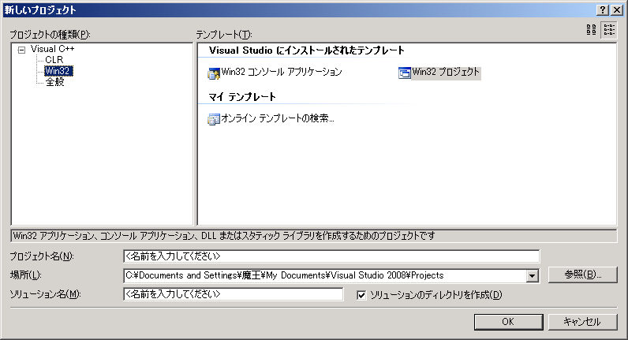</div>


```
側近「まずは、プログラミングの基本中の基本、『Hello, World!』を作っていただきます
　『Win32 コンソール アプリケーション』をお選び下さい。プロジェクト名はどうぞご自由に」
魔王「ではコンソール……hellowork……っと
　何やら、何とかウィザードなるものが出てきたぞ！　イオナズンでもしてくるのか！？」
　http://www8.uploader.jp/dl/vipprog/vipprog_uljp00674.png.html
```


<div class="pukiwiki-ref">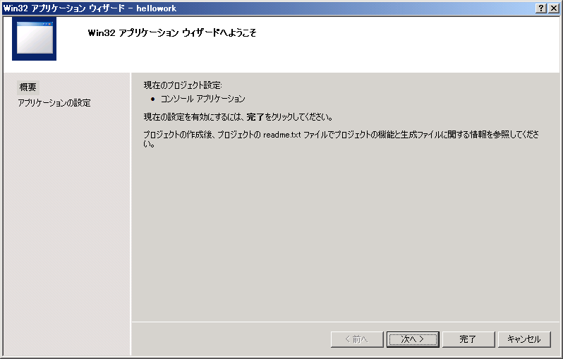</div>


```
側近「いえ、魔法使いのウィザードではなく、便利な設定ツールという意味でございます
　今回は、そのまま[完了]を押して下さいませ」
魔王「ふむ。このような画面になったぞ。これはどういう意味なのだ？」
　http://www8.uploader.jp/dl/vipprog/vipprog_uljp00675.png.html
側近「これから、プログラミングらしい作業になりますよ、魔王様」
```


```
32 以下、名無しにかわりましてVIPがお送りします[] 2009/01/31(土) 21:16:54.97 ID:9NKa2DM90
魔王「プログラミングらしいとからしくない以前に、まずこの文章の意味がわからんのだが」
側近「おおっと、私としたことが失礼いたしました
　まず、最初の2行ですが、色が緑になっていることがお解りでしょう？」
　http://www8.uploader.jp/dl/vipprog/vipprog_uljp00675.png.html
```


<div class="pukiwiki-ref">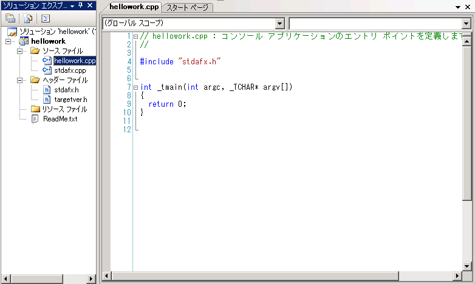</div>


```
魔王「ここだけ日本語が含まれているようだな
　コンソール……エントリ ポイント……日本語でおｋ」
側近「この、最初が//で始まる部分はコメントと言いまして、プログラムの動作には無関係なのです
　コメントは、多くの場合プログラムの注釈や要約を書くために利用されます」
魔王「おお！　適当に//を入れたらその後が全部緑になったぞ！　コメントになったのだな！！」
側近「ご明察の通りでございます。その部分を消すと元に戻りますでしょう？
　余談ですが、C++では//以外に、/*と*/で挟んだ部分もコメントになります
　こちらは行の途中だけや、複数行に渡った部分をコメントとすることができますね」
　http://www8.uploader.jp/dl/vipprog/vipprog_uljp00676.png.html
```


<div class="pukiwiki-ref">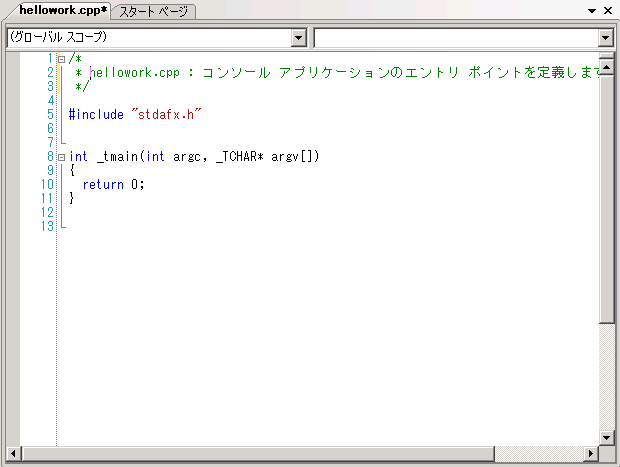</div>


```
41 以下、名無しにかわりましてVIPがお送りします[] 2009/01/31(土) 21:56:19.01 ID:9NKa2DM90
魔王「では次の、#include というのは何なのだ？」
側近「その後ろに、"stdafx.h"というのがおありでしょう」
魔王「うむ。左側の[ソリューション エクスプローラ]にも stdafx.h があるな」
側近「流石は魔王様。まさに""の中に指定したファイルを読み込めという命令でございます」
魔王「ほう。ではこれをこうすれば……
　http://www8.uploader.jp/dl/vipprog/vipprog_uljp00677.png.html
```


<div class="pukiwiki-ref">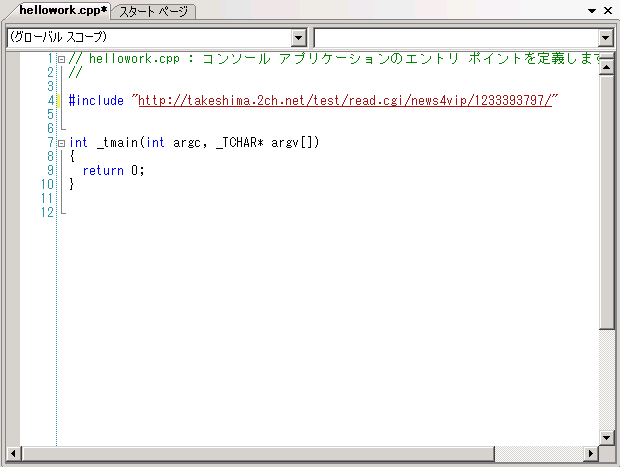</div>


```
　このスレ用の専ブラが完成というわけか。簡単ではないか」
側近「いえ、残念ながら……
　#include は、指定したファイルの中身を、“その場所に書いた”ように振舞う命令です
　そもそもウェブ上のファイルにアクセスできませんが、
　できたとしてもこのスレはC++のソースコードではありません」
魔王「そうか……まあよい
　つまり、stdafx.h の中の #include では、targetver.h と stdio.h と tchar.h を読んでいるのだな
　http://www8.uploader.jp/dl/vipprog/vipprog_uljp00678.png.html
```


<div class="pukiwiki-ref">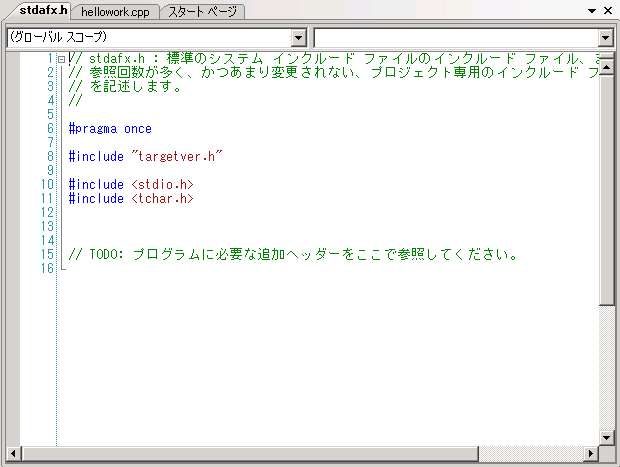</div>


```
　……はて。stdio.h と tchar.h はどこにあるのだ？　囲いが<>になっているのも気になるが」
側近「魔王様、鋭いところにお気づきになられました」
```


```
45 以下、名無しにかわりましてVIPがお送りします[] 2009/01/31(土) 22:26:28.50 ID:9NKa2DM90
側近「実は、<>で囲ったものは、標準ヘッダを使え、という意味になるのです
　標準ヘッダというのはコンパイラがあらかじめ用意しているファイルで、
　ファイルごとに様々な基本的な機能を提供しているのです
　stdio.h は主にファイル入出力。tchar.h は ANSI 文字と Unicode 文字を統一的に扱うものですね
　この辺りは、今はお覚えになる必要はございません」
魔王「うむ、確かにこれは深入りしてはいけなさそうだ。“そういうもの”とでも思っておこう
　http://www8.uploader.jp/dl/vipprog/vipprog_uljp00679.png.html
```


<div class="pukiwiki-ref">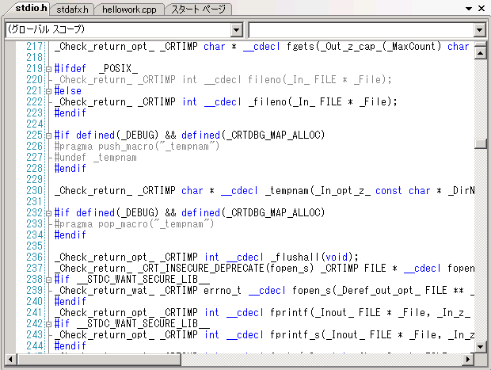</div>


```
　そういえば、#pragma once というのはどういう意味だ？」
側近「例えば、同じファイルを何度も #include したとします
　すると、同じ内容がその回数だけコピーされたことになるのはおわかりですね？
　同じ内容がその回数だけコピーされたことになるのはおわかりですね？？
　同じ内容がその回数だけコピーされたことになるのはおわかりですね？？？」
魔王「わ…わかったわかった……わかったから近寄るな」
側近「つまり、そうならないように2回目以降の #include は無視せよという意味でございます」
魔王「次は targetver.h の中身についてだが……」
　http://www8.uploader.jp/dl/vipprog/vipprog_uljp00680.png.html
```


<div class="pukiwiki-ref">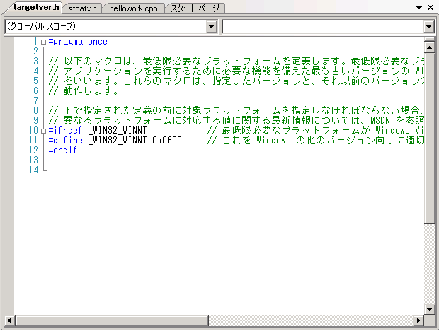</div>


```
側近「それは Windows 固有の機能を使う時に必要になるだけなので気にしなくて構いません」
```


```
54 以下、名無しにかわりましてVIPがお送りします[] 2009/01/31(土) 23:01:41.96 ID:9NKa2DM90
～側近のVC++講座(2)～

側近「それでは、本題に入りましょうか
　まず、C++には『データ型』というものがあるのです
　http://www8.uploader.jp/dl/vipprog/vipprog_uljp00675.png.html
```


<div class="pukiwiki-ref"></div>


```
　ここでは、int というのがそれに当たります
　int は約-21億～+21億までの整数を入れることができる箱の規格だと思って下さいませ
　同様に、-32768～32767までの整数が入る short 、小数が入る double などがあります」
魔王「面倒ではないか。何でも入るのはないのか？　カー○ィみたいな」
側近「C++では、標準ではございませんね
　何でも入るようでは、取り出す時に毎回、入っているのが欲しいものかどうかチェックする必要があります
　例えば……そうですね、もし醤油差しにタバスコが入れられるようになっていたら、
　お食事が刺身の時に困りますでしょう？」
魔王「え！？」
側近「ええっ！？」
```


```
59 以下、名無しにかわりましてVIPがお送りします[] 2009/01/31(土) 23:33:12.08 ID:9NKa2DM90
側近「次ですが……魔王様にご説明するのはいささか尚早ですので()の中は消して下さいませ
　http://www8.uploader.jp/dl/vipprog/vipprog_uljp00681.png.html
```


<div class="pukiwiki-ref">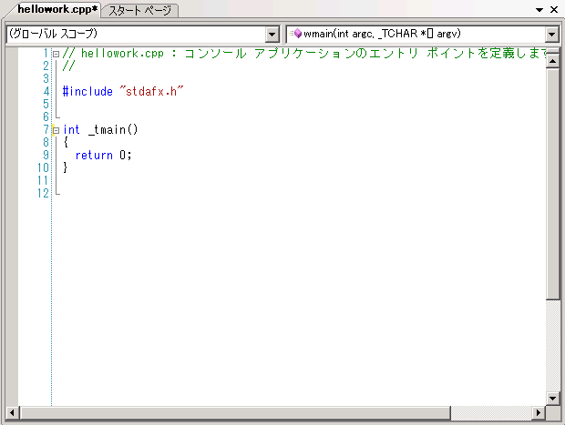</div>


```
　この _tmain というのは、プログラムの本体でございます
　つまり、プログラムを実行した時の処理を書くのです
　大抵の解説サイトでは main という名を用いておりますが、
　tchar.h をインクルードする際には代わりに _tmain を使うのです」
魔王「で、今消した()の中身は何なのだ？　あと最初の int」
側近「実はこの _tmain 、『関数』と呼ばれるものでして、
　関数とはデータを与えると処理をして結果を求める一連の処理のことを指すのです
　関数は『型名 関数名(引数) { 処理 }』という形式で、
　先程の int は『型名』、()の中身は『引数』、すなわち与えられたデータだった、ということです」
魔王「つまり、引数が不要であるから()の中身を消したのだな
　しかし、最終的に『Hello, World!』と表示させるとしたら、結果は整数ではいけないのではないか？」
側近「_tmain は、結果を表示するわけではございません故
　_tmain は、処理に成功したなら 0 、失敗したならそれ以外と決まっております
　尤も『Hello, World!』の表示に失敗するというのは、通常であればないと見てよろしいですが」
魔王「つまり今の _tmain では、『何もしない』という処理に自動的に成功して 0 を求めたのだな
　……return の後に書かれた 0 が結果だと思ってよいのだな？」
側近「左様で」
```


```
75 以下、名無しにかわりましてVIPがお送りします[] 2009/02/01(日) 00:06:34.95 ID:8exhkjt30
側近「それでは、実際に『Hello, World!』の文字を表示することにいたしましょう
　まずは文字の表示のために、<iostream>をインクルードなさいませ」
魔王「できたぞ。他と違って『.h』はないがよいのだな？」
　http://www8.uploader.jp/dl/vipprog/vipprog_uljp00682.png.html
```


<div class="pukiwiki-ref">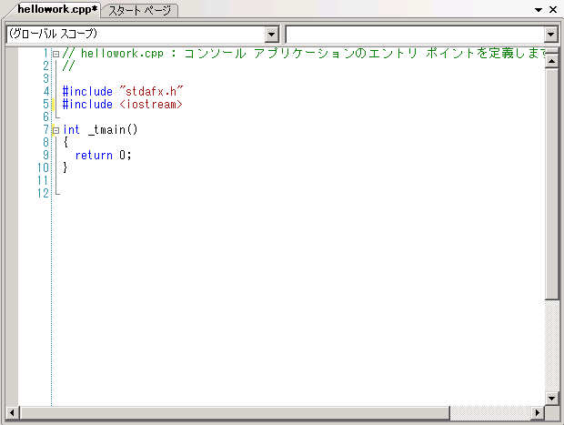</div>


```
側近「構いません、ないのが仕様でございます
　さて、C++で文字を表示するには、『std::cout』を用います
　先程のインクルードは、これを使うための布石でございますね
　『std』の部分は『名前空間』と申しまして、言わば苗字のようなものでございます」
魔王「『苗字::名前』ということか。同じ名前の者がいても、混同しないようにするのだな
　ということは、『std::dout』やら『ste::cout』みたいなものもあるのか？」
側近「dout はございませんが、std::cin やら std::vector やらといったものがございます
　cout を含む std 以外の名前空間は寡聞にして存じませんが、
　標準機能は全て同じ名前空間にしておく方がわかりやすうございましょう
　標準＝STandarDなのでございます」
魔王「で、その std::cout をどう使えばよいのだ？」
側近「『std::cout << 表示したいもの』といたします
　『<< 表示したいもの』は連続して指定いただけますよ
　あ、文字列は""で囲むようになさいませ」
魔王「std::って打っただけで候補がたくさん出てきた！！」
　http://www8.uploader.jp/dl/vipprog/vipprog_uljp00683.png.html
```


<div class="pukiwiki-ref">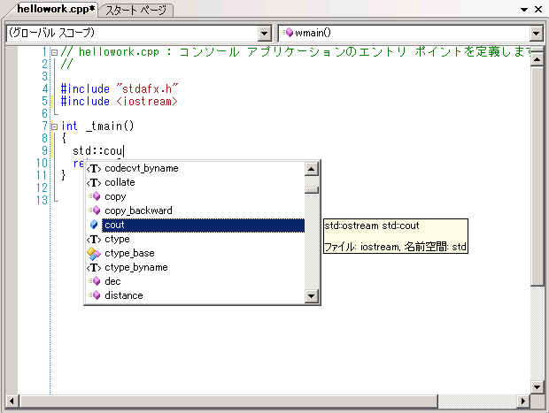</div>


```
側近「それがプログラミング専用エディタの威力でございます」
```


```
80 以下、名無しにかわりましてVIPがお送りします[] 2009/02/01(日) 00:11:40.04 ID:8exhkjt30
側近「言い忘れましたが……」
魔王「？」
側近「1つの命令の終わりには、『;』をお付け下さいませ
　日本語における『。』のようなものでございますので、欠かしてはなりません」
魔王「さっきからずーーっと欠かしてるけどね、『。』」

83 以下、名無しにかわりましてVIPがお送りします[] 2009/02/01(日) 00:24:50.48 ID:8exhkjt30
魔王「できたぞ！　そろそろ実際に動かして見てみたいのだが」
側近「では、このボタンをお押し下さいませ」
　http://www8.uploader.jp/dl/vipprog/vipprog_uljp00684.png.html
```


<div class="pukiwiki-ref">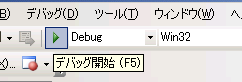</div>


```
魔王「ポチっとな……何か処理をしているようだな」
側近「コンパイルでございますね。ソースコードを、PCが実行できる形式に変換しているのです
　……おっと、そろそろ終わりますよ」
魔王「おおっ！　何かが出てきたぞ！
　！……一瞬で消えたっ！？」
側近「はっ、私としたことが……
　プログラムは確かに開始して、文字を表示いたしておりました
　そして表示が終わり、プログラムが終了したためウィンドウが消えたのでございます
　……代わりに、こちらのメニューを実行してみてはいただけますか？」
　http://www8.uploader.jp/dl/vipprog/vipprog_uljp00685.png.html
```


<div class="pukiwiki-ref">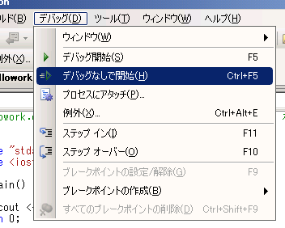</div>


```
魔王「おお、今度は表示が残ったぞ！
　……しかし、何かが変ではないか？」
　http://www8.uploader.jp/dl/vipprog/vipprog_uljp00686.png.html
```


<div class="pukiwiki-ref">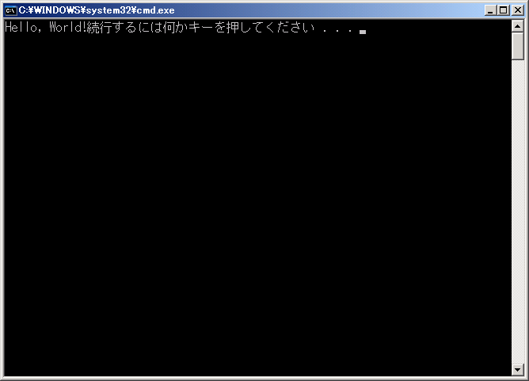</div>


```
89 以下、名無しにかわりましてVIPがお送りします[] 2009/02/01(日) 00:50:18.60 ID:8exhkjt30
側近「!の後で改行すべきでございますね、改行するには……」
魔王「うむ、これでよいはずだ！
　http://www8.uploader.jp/dl/vipprog/vipprog_uljp00687.png.html
```


<div class="pukiwiki-ref">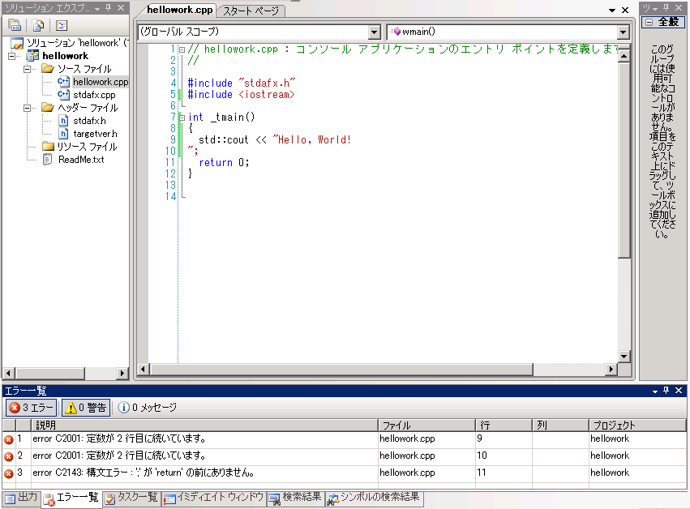</div>


```
　……何だこのエラーは！」
側近「文字列は、複数行に渡って書くことはできないのでございます
　C++ではその代わり、特別な書き方をいたします」
魔王「何故それを先に言わない！」
側近「いえ、話をお聞きにならなかったのは魔王様でして……」

？？「そこまでだ魔王！」

側近「何者！？」
？？「>>67に呼ばれて、勇者ただいま見参！　とうっ！！」
魔王「おのれ勇者……もう少しで禁断の秘術を手にできるものを……」
勇者(こいつ…PCに向かいながら何言ってるんだ……？)
魔法使い(禁断の秘術でもググってるんじゃないかしら？)
戦士「秘術は秘術でもネトゲのだったりしてなｗｗｗｗｗ」
魔王「ええい、言わせておけば！　この画面のどこがネトゲに見えるのだ！」
勇者「どれどれ……いやさすがにこのコードはねーわ。直しといてやるよ」
　http://www8.uploader.jp/dl/vipprog/vipprog_uljp00688.png.html
　http://www8.uploader.jp/dl/vipprog/vipprog_uljp00689.png.html
```


<div class="pukiwiki-ref">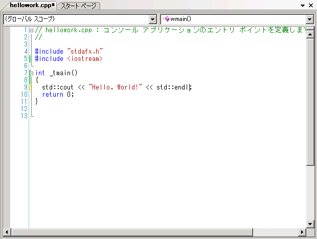</div>


<div class="pukiwiki-ref"></div>


```
魔王＆側近「……」
勇者「？」
魔王「ゆ…勇者のバカーーーーーｳﾜｧｧｧﾝ！！！！！」

――かくして、勇者の活躍により、世界の平和は守られたかのように見えた
　 　 しかしそれは、これから始まる大いなる戦いの序章に過ぎなかった
　 　 世界の覇権を巡る勇者と魔王の戦いは、この後熾烈を極めてゆくのである――

魔王「わしの側近はｽｰﾊﾟｰﾊｯｶｰなんだぞ！　IP抜いてウイルス送るから覚えとけよ勇者！！」
```
