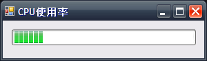

# C#チュートリアル {#a337d410}


# はじめに {#idd81ac4}

- wiki書くの初めてだからいろいろと許してください＞＜
- 僕はF700isさんではないです＞＜


# プログラミングとは何か {#wce3cd26}
プログラミングとはコンピュータに対して命令をする事です。プログラミングを学ぶことによってコンピュータでできるものは全部作ることが出来ます。

# プログラミング言語とは何か {#pd0b363c}
コンピュータは0か1の2進数の言葉しか理解することは出来ません。これを機械語といいます。人間がこれを理解するのは限りなく難しいです。そこで人間と機械の橋渡しをしてくれるものがプログラミング言語です。丁度人間の話す言葉と機械語の中間のような存在です。

# C#の特徴 {#i065a934}
C#は先進的な文法を取り入れた比較的新しい言語です。すばやくアプリケーションを作れる事が特徴です。またCやJavaの文法に近く親しみやすく、すぐになれることができるでしょう。

# IDEの導入 {#iee08282}
プログラミングはメモ帳だけでもすることはできますが、いろいろと不便です。プログラミングするにあたって便利な道具を詰め合わせたものが開発されています。それがIDE（統合開発環境）です。C#にはVisual StudioというIDEがあります。Express Editionは無料ですので是非導入しましょう。[プログラミング言語/C Sharp](/docs/プログラミング言語/C-Sharp)のページに解説があります。以下VSを前提として解説します。

# GUIアプリ編 {#b6cf50eb}
## プロジェクトをつくる {#z3c64e4b}
何か作るときはプロジェクトを作らなければいけません。作ったものはプロジェクトへ保存されます。
「ファイル」→「新しいプロジェクト」→「Windowsアプリケーション」
プロジェクト名は好きな名前を入れてください。でおｋ

そうするとForm1と書かれたウィンドウが出ると思います。
F5または緑の矢印ボタンまたは「デバッグ」→「デバッグで開始」でプログラムを実行できます。たったこれだけで何もしないプログラムの出来上がりです。

簡単だね☆

## C#ツールボックスを使おう {#p4a99afe}

右側にツールボックスがなかったら「表示」→「ツールボックス」で表示しよう
さてツールボックスからボタンをドラッグ&ドロップで好きな位置に置こう
実行すると好きなだけ押せるボタンが作れるぞ!<br />

できたらいろんな部品をぽとぺたしよう! 

## プロパティをいじくろう {#ke65c07d}

設置した部品を選択しよう 右下にプロパティが表示されてるかな?
ボタンを選択したらTextのところを探して好きな文字に変更してみよう。
BackColorやFontも変えてみよう!

## イベントを作ろう {#f74dfa99}

さていきなり作ったボタンをダブルクリックしてみよう。
いきなりテキストエディタに飛ばされるはずだ。
意味はそのままでボタン(button)が押された時(Click)ここに書かれたコードが実行されるんだ。
そこに

```
private void button1_Click(object sender, EventArgs e)
{
 MessageBox.Show("働け");
}
```

と書いて実行しよう
そうしてボタンを押すと…

## ラベルを追加しよう {#f54a8884}

ラベルは好きな文字を表示できる部品(コントロール)です
表示する文字はTextプロパティで変更できます
さて実行する前は変更できるようになったね? 次はボタンを押したらラベルの内容を変更されるようにしよう。

さっき MessageBox.Showを書いたとこの一行下に書こう。
　label1.Text = "うほっ";
これはlabel1(ラベルの名前)のTextプロパティに"うほっ"を入れるという意味です。
文字は""で囲んであげる必要があります。
=は等しいという意味ではありません 右のものを左へいれるという意味で､代入といいます<br />

# コンソール編 {#y4c9ca8b}
## エントリポイント {#k14b84a6}
ここからはプログラムの基本を学びます。そのためコンソールアプリというものを作ります。今までのようにボタンとか出てきません。真っ暗な画面に文字が表示されるだけの質素なものです。つまらないかもしれませんが大切な課程です。

「新しいプロジェクト」から「コンソールアプリケーション」を作りましょう。
今度はフォームが現れずにコードが表示されましたね?


```
using System;
using System.Collections.Generic;
using System.Text;

namespace ConsoleApplication1
{
	class Program
	{
		static void Main(string[] args)
	        {
	        }
	}
}
```


いきなり沢山書かれて戸惑うかも知れませんが一度に全て理解する必要はありません。
まずstatic void Main～の部分はエントリポイントと言ってプログラムが実行されたとき一番最初に実行される部分です。
次からコードはこの{}の中に書いていきます。

## 文字を表示する {#d2c96225}
画面に表示する命令はSystem.Console.WriteLine();という命令です。
ちょっと長いですね^^ でも省略する方法があります。
それがコードスニペットです ctrl + k , xで候補がでます。
cwと打って決定するとあら不思議。(System.は無くてもかまいません)

さてスニペットを使って入れたWriteLine()の()の中に表示したいものを入れましょう。
例えば"HelloWorld!"と入れてみましょう<br />


```
static void Main(string[] args)
{
	System.Console.WriteLine("ぬるぽ");
}
```


さて先ほどと同様に実行しても実行結果が見えない早さで閉じてしまうので「デバッグなし」で実行を選びましょう。またはCtrl+F5でおkです。

確認したら次へ進みましょう <br />

## 計算をする {#gab7aee2}
目の前の箱は電子計算機なんですから計算をさせてみましょう。
先ほどの()の中身を書き換えます。
計算はそのまま(3+5)や(4*5)と書けば結果が表示されます ""は文字じゃないので今回は使いません<br />
加減算よりも剰余算が優先されます 普通の式と一緒です。
()も使う事ができます。
WriteLine((3+5)*2)のように書けます 掛け算は省略できません。

ちょっと注意なのは割り算です 記号は/です<br />
でも(10/3)とかやっても変な結果が出ると思いますが まあ後でやりましょう。


```
Console.WriteLine(2+3);
Console.WriteLine(3-5);
Console.WriteLine(3*2);
Console.WriteLine(10/3); //変な結果が表示される
```


## 変数 {#i750bb84}

さて電卓にもメモリー機能があるようにコンピュータも情報を保存することができます。
ちなみにファイルに保存とは違います。ちょっとだけ保存です。
情報を保存するには場所を確保しなければなりません 。の場所のことを<strong>変数</strong>といい 確保することを<strong>変数の宣言</strong>といいます。

宣言するためには型を指定する必要があります。型とはどんな情報であるかという種類を表しています。
例えば文字を格納する変数の型は string です。
整数を格納する変数の型は int です 整数の英語integerの略です。

変数を確保するときはその場所に名前をつけます 名前はかぶってはいけません。
数字で始めることはできません。できるだけアルファベットを使いましょう。
日本語も使えますがやめたほうがいいです。

変数の宣言は以下のようにします。

```
型名 変数名;
```

例えば整数を格納する変数seisuの宣言は<br />

```
int seisu;
```

となります。 

## 変数への代入 {#ud6b6ec3}

変数に値を入れることを<strong>代入</strong>と言います。文法は 

```
変数名 = 値; 
```

です =は等しいと言う意味ではありません。
右から左へ値を代入することを意味しています。
先ほどのseisuに10を代入しましょう。

```
seisu = 10; 
```

ちなみに先ほどのintと宣言しましたので<strong>整数以外を入れる事ができません</strong>。 

```
seisu = 12.3; 
```

はエラーになります 

## 変数の表示 {#p3eefba4}
変数の中身を表示する事もできます。

```
Console.WriteLine(seisu); 
```

と書けば変数の中身が表示されます また 

```
Console.WriteLine(seisu*seisu); 
```

とやることで変数を利用して計算することもできます 

```
Console.WriteLine(seisu + 5); 
```

とかももちろんできます  


```
static void Main(string[] args)
{
      	int seisu = 10;

      	Console.WriteLine(seisu);
      	Console.WriteLine(seisu*seisu);
      	Console.WriteLine(seisu + 5);
}
```


上記のように変数は初期化と同時に代入できます。

## 時計の表示 {#e6fd3cfe}

日付と時間はDateTime構造体を使えば取得できます。構造体が何かはひとまず置いておきましょう。
ちなみにC#の説明書みたいなのはMSDN Libraryにあります msdn DateTime などで検索すると説明が探せます。（最初は読めないと思いますが慣れてくれば大丈夫です）

さて日付と時間を格納する変数の型はDateTimeです。
現在の時間を取得するのは以下のようにします。

```
DateTime jikan = DateTime.Now;
```

DateTime.Nowには現在の時間が入っています。表示は

```
WriteLine(jikan);
```

で表示できます 

これで時間と日付が表示できるはずです^^ 


```
static void Main(string[] args)
{
	DateTime jikan = DateTime.Now;
	Console.WriteLine(jikan);
}
```


## 関数(メソッド) {#x6ec72d7}
プログラミングにおいて欠かせないもの、それが関数です。メソッドとも呼ばれます。関数はちょうど数学の関数と同じようなものです。たとえば

```
f(x) = x^2
```

という中学校でよくやったような関数があります。xに1を入れれば1、2なら4が答えになります。プログラミングにおける関数でxの事を<strong>引数</strong>（ひきすう）と言い、返ってくる答えを<strong>戻り値</strong>(返り値)といいます。

関数は<strong>関数名()</strong>で表されます。
<strong>()がついてないものは変数</strong>ですので区別できますね。
引数は()の中に書きます どんな引数を取るかは関数によって変わります。VSなら引数の情報が自動的に表示されて便利です。
実際の使い方ですがWriteLine()という関数は文字列を引数にとります。(実際はだいたいなんでもおkなんですけど)なので使い方は 

```
Console.WriteLine("働け");
```

となります 

また累乗を求める関数Math.pow()は引数に数字(double)を2つとります。double型は実数を格納できる型です(少数も格納できる) 書き方は 

```
Math.Pow(2,3); 
```

のように,で区切ります。もちろん答えが返ってきます。結果を利用するにはdouble型の変数を利用して 

```
double kotae = Math.Pow(2,3); 
```

とします これで2の3乗ができました  

## 関数を作る {#we9de9ef}

さて今まではstatic void Mainというところに書いていました。
よく見たら()がついてますね? 実はこれも関数なんです。
Mainという関数は特別で１番最初に実行される関数です。 
なので今まではMain関数を作ってきたことになります。

このように自分で好きなように関数を作る事ができます。書式は 

```
アクセス修飾子 戻り値の型 関数名(引数のリスト){}
```

です 今度はわけわからん感じですがとりあえずアクセス修飾子はひとまず置いておきましょう(staticがこれにあたります。)

さて、はじめてなので与えられた数字を倍にする関数を作りましょう。数学で表すとf(x)=2xですね。
場所はMain{}の外の下にしましょう。
今回はintを受け取ってintを返しましょう。なので 

```
static int bai(int a){} 
```

が関数の宣言部になります。C#は慣例的に最初の一文字目は大文字で始め動詞をつけます 動作が解りやすいように名付けましょう。
aは好きな名前をつけることができます。最初のintが戻り値の型で、()の中のintが引数の型です。関数は{で始まり}で終わります。処理は{}の中に書くようにします。(staticは気にしないで下さい。とりあえずつけておきましょう)

次に2倍する処理を書きます 

```
int kotae = a * 2; 
```

与えられた数字はaに入っているので2をかけて倍にします 
次に答えを返します 返すには<strong>return</strong>キーワードを使います。答えはkotaeに入っているので

```
return kotae;
```

と書きます returnしたら関数は処理を終了します。

では作った関数をMainから使ってみましょう 
Mainの中に 

```
int x = bai(10); 
Console.WriteLine(x); 
```

とすると20と表示されるはずです。

今回のソース

```
class Program
{
       static void Main(string[] args)
       {
           int x = bai(10);
           Console.WriteLine(x);
       }

       static int bai(int a) 
       {
           int kotae = 2 * a;
           return kotae;
	}
}
```

どのようにプログラムが流れていくかしっかり理解しましょう。

## 省略記法 {#g8a3bd12}
さてint型変数iがあるとしよう。
これに何が入っているかわからないが1を足したい。
どういうコードを書けばいいだろうか?。
頭を働かして考えて欲しい。

答え

```
i = i + 1;
```


i = i + 1;はなんとなく気持ち悪いかも知れない。数学的に矛盾しているからだ。でも慣れて欲しい。
さてC#はCの血が流れていて省略の美学というものがある。いくつかよく使うものを紹介しよう。

```
i += 1; 
```

これは上式とまったく同じ意味。この方が見やすいかな?
そして<strong>1</strong>を足す場合にだけはさらに特別に省略できる。

```
i++; 
```

これも同じ意味である 1を足す場合は良くあり使われるので覚えておこう。

ちなみに足し算だけでなく 

```
i -= 1;
i *= 1;
i /= 1;
```


なども同様にできる。
ちなみにi--もある。

## Powを作ろう {#l5d20745}

累乗を計算する関数Powを自分で作ってみよう。
まず引数を決めよう。今回は簡単のためint型変数を2つとろう。
2.1の0.86乗とかなるとめんどくさいので 2の3乗のようにします。
返り値は整数の掛け算だから答も整数になるのでint型でいいだろう。

これを元に関数の宣言を自分で書いてみよう 

答え

```
static int Pow(int x,int y)
{
}
```


## 繰り返し構文 {#o2a70e67}

さて累乗をするPow関数を作成しよう。引数x,yを使いxのy乗を計算する。
例えば2の3乗なら2*2*2で､単純に繰り返せばいい事がわかる。
つまり引数を使ってx*x*x…をy回やればいい事になる。

ではこのように繰り返しを表現するにはどうすればいいのだろう?
C#には<strong>for構文</strong>が用意されている。これを使おう。

さて書式は 

```
for(初期化式;繰り返し条件;繰り返し式){}
```

であるけどこれではよくわからないので単純に10回繰り返すサンプルを書いてみる。 

```
for(int i=0;i<10;i++){} 
```

まずint i=0はforが始まる前に一回だけ実行される。iは慣用的に使われる名前で何回繰り返したか数えておく変数である。

i<10はiが10未満という条件が満たされている間繰り返しなさいという意味である。

i++は一回繰り返す度に実行される 1回繰り返すとiに1足していくので数えられる。

これがfor文の基本系だ しっかり理解しよう 
ちなみに0から始めるには理由があるのでそんなもんかとおもっておこう。0から始めるので条件は10<strong>未満</strong>である。気をつけよう。

さて今回はy回繰り返したい。基本系をちょっと変えてy回繰り返せるように考えよう。

答  
for(int i=0; i<y; i++){} 

## Pow関数の実装 {#f58727be}
さてy回繰り返す方法を学んだ。これを使ってPowを計算しよう。
今回は負数は考えない。繰り返すたびに掛け算をすることがポイントだ。

答え

```
class Program
{
       static void Main(string[] args)
       {
           int x = Pow(2, 16);
           Console.WriteLine(x);
       }

       static int Pow(int x, int y)
       {
           int result = 1;

           for (int i = 0; i < y; i++)
           {
               result *= x;
           }

           return result;
       }  
}
```

## 魔法使いかどうか判定する {#i549d509}
童貞は30を迎えると魔法使いになれるといいます。
年齢を尋ねて、魔法使いかどうか判定しましょう。

### 年齢を取得する {#h3ac86dd}
まず、年齢を入力してください。と表示します。

```
Console.WriteLine("年齢を入力してください。");
```

次に年齢を入力してもらうのですが、どうすればいいのでしょうか？ここは想像力を働かせましょう。WrteLineがあるのですからReadLineもありそうですね。早速MSDNで検索しましょう。
[ReadLineメソッド](http://msdn2.microsoft.com/ja-jp/library/system.console.readline(VS.80).aspx)が見つかりました。

```
標準入力ストリームから次の 1 行分の文字を読み取ります。
```

と書いてあるのでこれでよさそうです。標準入力ストリームは通常画面を指します。

構文のC#の部分を見ると

```
public static string ReadLine ()
```

と書かれています。publicは習ってませんが無視してください。これを見るとstringを返す関数であることが分かります。引数は何もありませんね。なので

```
string age_str = Console.ReadLine();
```

でage_strに入力された文字を取得することができます。

### 数字へ変換する {#se0e6fe7}
これで年齢は取得できましたがstring型であることから分かるように文字列です。つまり直接<strong>数字として扱うことは出来ない</strong>のです。

そこで文字列の中の数字をint型へ変換してくれる関数があります。
それがConvert.ToInt32()メソッドです。32とかついてるけど気にしないで下さい。

早速MSDNで調べてみましょう。[Convert.ToInt32 メソッド (String)](http://msdn2.microsoft.com/ja-jp/library/sf1aw27b(VS.80).aspx)

```
指定した String 形式の数値を、それと等価な 32 ビット符号付き整数に変換します。
```

なのでこれでよさそうです。いろいろと注意事項なども書いていますがまあいいでしょう。使い方は引数に変換もとのage_strを入れましょう。

```
int age = Convert.ToInt32(age_str);
```

これで年齢が取得できました。

### 30以上かどうか判定する {#mb8e17c3}
年齢が取得できましたので今度は30以上かどうか判定します。
このように条件によって処理を変える必要があるとき使うのが<strong>if構文</strong>です。もし～だったら～するを表現します。

```
if(条件式)
{
	//条件が真の時
}
else
{
	//条件が偽の時
}
```

elseは違えば～するです。

### 完成 {#tf6100c3}
30以上という条件は

```
age >= 30
```

と書くことが出来ます。=が後ろにつくのは今までと一緒ですね。
がんばって完成させましょう。

答え

```
class Program
{
       static void Main(string[] args)
       {
           Console.WriteLine("年齢を入力してください。");

           string age_str = Console.ReadLine();
           int age = Convert.ToInt32(age_str);

           if (age >= 30)
           {
               Console.WriteLine("あなたは魔法使いです");
           }
           else 
           {
               Console.WriteLine("あなたは魔法使いではありません");
           }
       }
}
```


## 数当てゲーム {#s309cd93}
初心者用課題のひとつ、数当てゲームを作成しましょう。以下引用


```
これは答えの数を探すゲームです。適当な数を入れると正解より も大きいか小さいか,または正解であるか出力されます。
それを 繰り返すことで答えを探すことができます。このゲームを作成し なさい。答えの数は乱数を使って毎回別の答えを用意しましょう。
```


### while構文 {#b574b6e9}
乱数で答えを用意するのは後回しにしましょう。問題文を読めば分かるように繰り返す必要があるようです。しかし、今回は繰り返す回数がわかっていません。1回で正解する時もあるかもしれませんが、10回やってもだめかもしれません。このような時に使うのが<strong>while構文</strong>と呼ばれるものです。

書式は

```
while(条件式){}
```

条件式が満たされている間{}の中の処理を繰り返します。条件式の中にはage < 30のような条件も書けますが<strong>true</strong>と書くことも出来ます。trueは条件が満たされた<strong>真である</strong>事を意味しています。つまり常に条件が満たされている状態なので<strong>無限ループ</strong>になります。

無限ループを作ったときは必ず脱出できるようにしなければいけません。この場合正解したときループを抜けたいですね。そのとき使うのが<strong>break</strong>です。break;と書くとその場でループを抜け出すことが出来ます。

### 等号 {#z0d4d1c3}
=は等しいという意味ではありませんでした。では等しいという条件はどう書くのでしょうか？

等号は==で表します。age == 30でageと30が等しいという意味になります。また、等しくないという条件は!=で表します。

### else if {#p9e72e74}
先ほどelseを勉強しましたがelseの後にまたifを書いて条件分岐させることができます。
いくつでも繋げて書く事ができます。


```
if(～)
{
}
else if(～)
{
}
else
{
}
```


### 完成 {#r5b4dd6b}
数字を読み取るところを2行から1行にまとめて書いています。こういう書き方もできます。最後のif(num > answer)は別に必要ではありませんが一応書いてあります。

書くの忘れてましたが//はコメントを意味します。//から後ろは実行されません。ちょっとしたメモを書いておくことが出来ます。


```
class Program
{
	static void Main(string[] args)
	{
		int answer = 30;

		while (true)
		{
			Console.WriteLine("数を入力してください。");

			int num = Convert.ToInt32(Console.ReadLine());

			if (num == answer)
			{
				Console.WriteLine("おめでとう。正解です。");
				break;						//ループから抜け出す。
			}
			else if (num < answer)
			{
				Console.WriteLine("小さいです");
			}
			else if (num > answer) 
			{
				Console.WriteLine("すごく…大きいです…");
			}
		}
	}
}
```


## 乱数を作る {#x1e591f7}
乱数とはさいころのようにランダムな数列の事です。コンピュータでは計算で擬似的に乱数を作り出しているので擬似乱数と呼ばれます。乱数扱うにはRandomクラスを使用します。

### クラスとは? {#o8599c81}
僕はうまく説明できません^^　

プログラミングの仕方にオブジェクト指向というものがあります。オブジェクト指向とは部品を組み上げるようにプログラミングしよう、というものです。ちょうどLEGOブロックのように。クラスとはその部品の設計図です。クラスを実際に使いたいときは<strong>インスタンス</strong>を生成しなければいけません。と難しく解説しても使い方はいままでの変数とあまり変わりません。実際にRandomクラスのインスタンスを生成してみましょう。


```
Random rnd = new Random();
```


new以外見慣れた形ですね。Randomクラスのrndという名前のインスタンスを生成しています。しかしこのままでは中身が入っていません。場所を確保しただけです。後ろのnewはインスタンスを生成せよという命令です。生成したインスタンスをrndへ代入しているわけです。後ろのRandomには()がついています。これは<strong>コンストラクタ</strong>という特別な関数です。クラス名+()で構成されます。決まった形なので覚えてください。

### Randomの使い方 {#pad0c855}
さて設計図から実際に使える部品が作れました。使い方を調べてみましょう。Randomにカーソルを持っていってF1でMSDNを引くことが出来ます。パブリックメソッドの項目が使える関数のリストです。Next～系がどうやら乱数を返してくれそうです。今回はNextメソッドを見てみましょう。

オーバーロードの一覧が表示されます。同じ名前の関数でも異なる引数を与えることで違う動作をさせることが出来ます。これを<strong>オーバーロード</strong>といいます。サンプルにさいころを作ってみましょう。1から6までの乱数が欲しいので「指定した範囲内の乱数を返します。」とある、 Random.Next (Int32, Int32)を見てみましょう。1,6を入れればよさそうに見えますが下の「戻り値」のところに注意書きが書かれています。読むと1～6の値が欲しいなら1,7と引数を与えなければいけないようです。ここは注意ですね。

### サイコロのサンプルプログラム {#ob817b2f}
10回サイコロを振るプログラムです。繰り返しですからfor文ですね


```
static void Main(string[] args)
{
	Random rnd = new Random();

	for (int i = 0; i < 10; i++)
	{
		Console.WriteLine(rnd.Next(1,7));
	}
}
```


## キャスト(型変換) {#wed76fe2}
Console.WriteLine(10/3);をしてみよう。結果は3と表示されるはずである。本来ならば3.3333…表示してほしいところである。実はint/intの計算は答えもintになってしまう。intは整数値しか示せないので少数は切り捨てられる(正確には0に近いほうに丸められる)。答えをdouble(実数)で欲しい時は、どちらか一方がdoubleであればよい。double/intでもdouble/doubleでもいい。ではどうすればいいのだろう？

### 小数点をつける {#ca3fd7a8}
10ではなく、10.0とする。

### サフィックスをつける {#g047d25e}
数字を直接書く場合10とかいう整数を書くと勝手にint型と認識されてしまう。double型と認識させるには数字の最後にdと書く。dと書くとdouble型と認識される。

```
Console.WriteLine(10d/3); //答えがdoubleで返ってくる
```


他のサフィックスは[数値のデータ型を明示的に指定するには？](http://www.atmarkit.co.jp/fdotnet/dotnettips/155numtype/numtype.html)を参照のこと。

### キャスト(型変換)する {#q1c5faf4}

```
(変換先の型名)変換したいもの
```

という書式で変数の型を変換することができる。これを<strong>キャスト</strong>と言う。

```
Console.WriteLine((double)10/3);
```

またこれは変数にも使える

```
int a = 10;
int b = 3;
Console.WriteLine((double)a/b);
```


## 変数の表現の範囲 {#ob2c3d62}
### int {#bd595df6}
int型は整数値を表現できると説明したが無限に大きい数を表現できるわけではない。int型は32bitの大きさであると決められている。これは2進数における桁数だと思ってもらうと2の32乗で、約42億程度まで表せることになる。実際には+-を表現するので+で21億～-21億程度までしか表現できない。大きな数を扱うときは気をつけよう。longというもっと大きい数まで表せる型もある。

### double {#x9f3461e}
double型は64bitの大きさです。つまりintの倍の大きさという事になります。[double (C# リファレンス)](http://msdn2.microsoft.com/ja-jp/library/678hzkk9(VS.80).aspx)を見てもらうととても大きな数を表すことができます。しかし、有効桁数が15～6桁となっています。つまりあまりにも大きい桁を表現すると下の位の情報が失われてしまう可能性があります。

### 暗黙的型変換 {#k7c16fb4}
intからdoubleへの変換は

```
int a = 100;
double b = a;
```

のように特別何も書かなくても型変換がおこなわれます。これはint型よりもdouble型のほうが表現できる幅が広く、情報が欠落する恐れがないためです。これを<strong>暗黙的型変換</strong>といいます。

### 明示的型変換 {#tf1319d7}
doubleからintへの型変換は

```
double a = 100;
int b = a;
```

と書いてもコンパイルエラーになります。これはdoubleよりint型の表現の幅が狭いため情報が欠落する恐れがあるためです。そこで情報が失われてもいいから変換してほしい場合は

```
double a = 100;
int b = (int)a;
```

と()を使ってキャストしてあげる必要があります。これを明示的型変換といいます。普通、キャストするといいます。この場合少数などの情報は失われてしまいます。


## 配列 {#c5128934}
さて学生数1200人の高校がある。数学のテストを実施したので平均点を出したい。どのようにプログラムしたらよいだろうか。点数は整数だろうからint型の変数を用意すればいいだろうが1200個も用意しなくてはならない。1200個も変数の宣言を書くのはさすがに無理だ。そこで<strong>配列</strong>というものが用意されている。これは変数をまとめて確保できるものだ。

### 配列の宣言 {#vfffaba2}
配列を宣言する書式を示そう。

```
型名[] 配列名 = new 型名[要素数];
```

実際にint型の変数を1200個用意するには

```
int[] mathScore = new int[1200];
```

と書けばいい。この配列の中の変数を利用するには[]を使う。中には要素の番号を入れる。番号は0番から始まるので、1200個の要素を確保したら<strong>最後は1199番</strong>になる。実際のコードは

```
mathScore[0]
```

で普通の変数のように使うことができる。また[]の中には変数を使うこともできる。[i]でi番目を参照できる。勘がいい人は気づいたかもしれないが配列はfor文と一緒に使うと便利だ。たとえば

```
for(int i=0; i < mathScore.Length; i++)
{
	Console.WriteLine(mathScore[i]);
}
```

で中身をすべて書き出すことができる。Lengthは要素数を取得することができる。これを見ればiが0ではじまり、条件に=がついてない理由がわかると思う。実にうまいことできてるもんだ。

### 適当なデータを用意する {#ydf55dbb}
では1200人分の数学のテストの平均点を求めるプログラムを書いてみよう。実際に1200人分のデータを入れるのは大変なので上で勉強した乱数を使ってみよう。点数は0～100点の間とする。繰り返しは上のfor文を真似して書いてみよう。

### 平均を計算する {#p712f1de}
平均はまず全部のデータを足して総数で割ればいい。全部のデータを足すのはやはり先ほどのfor文を使ってみよう。全員の合計点は整数になるが、平均は実数になる。キャストをうまく使ってみてほしい。

### 平均を求めるプログラム　解答例 {#k9cbd366}
今回は点数を0～100までランダムに出しているので平均は50前後になるはずである。


```
class Program
{
	static void Main(string[] args)
	{
		Random rnd = new Random();

		//点数を格納する配列
		int[] mathScore = new int[1200];

		//合計点を格納する
		int sum = 0;

		//ランダムな点数を入力する
		for (int i = 0; i < mathScore.Length; i++)
		{
			mathScore[i] = rnd.Next(100 + 1);
		}

		//総合計点を求める
		for (int i = 0; i < mathScore.Length; i++)
		{
			sum += mathScore[i];   
		}

		//平均を計算する
		double average = (double)sum / mathScore.Length;

		Console.WriteLine("平均は{0}点です。",average);

	}
}
```


## エラトステネスの篩 {#x31b3e35}
エラトステネスの篩とは素数を求めるもっとも原始的なやりかたである。詳しい解説はWikipediaを読んで欲しい。原理が簡単なので初心者用課題にもなっている。プログラミング初心者には歯ごたえがある問題かもしれない。がんばってくれ

### bool {#w4bed0ce}
エラトステネスの篩はまず順にならんだ数列を用意する。ということはさっき習った配列が使えそうである。エラトステネスの篩は素数でないものを消していけばいいので、ちょうど×がついているかついていないかの2通り表せればよさそうである。そこで使うのが<strong>bool</strong>型である。bool型は<strong>true</strong>か<strong>false</strong>の2通りしか表すことができない。ちょうどぴったりである。この手のプログラムでbool使ってるの見たことないけどチュートリアルだしいいよね☆

### 解き方 {#qa5ccf47}
まずbool型の配列を用意しよう。いくつまで求めるか事前に取得しておくといい。Console.ReadLineが使えるね。trueを素数とし、falseはそうでない状態を表すとしよう。まず2以上はいったん全部trueにする。

まず2番目から順に見ていきtrue(素数)ならその倍数を消していく。最初は2がtrueなので2,4,6,8…をfalseにしていく。そして次は3の倍数。4はもう消えてる(false)から飛ばして5の倍数…と最後まで続けよう。最後は求めた素数を表示しよう。

この課題は今まで習ったことすべてを使わないと解けない。頑張ってみよう。

### ヒント {#bd49cd69}
まず2の倍数、3の倍数と繰り返すにはfor文が1個いる。そして素数の倍数を消すのにもfor文がいる。つまり2重for文が必要になる。

```
for()
{
	for()
	{
	}
}
```


### 解答例 {#h5961d55}
わからなかった人も答えをしっかり理解しよう


```
class Program
{
	static void Main(string[] args)
	{
		Console.WriteLine("いくつまでの素数を表示しますか？");
		int num = Convert.ToInt32(Console.ReadLine());

		//trueなら素数
		bool[] prime = new bool[num + 1];

		//0,1は素数ではない
		for (int i = 2; i < prime.Length; i++)
		{
			prime[i] = true;
		}

		//エラトステネスの篩
		for (int i = 2; i < prime.Length; i++)
		{
			if (prime[i]) 
			{
				for (int k = 2; (i * k) < prime.Length; k++)
				{
					prime[i*k] = false;
				}
			}
		}

		//素数を書き出す
		for (int i = 0; i < prime.Length; i++)
		{
			if (prime[i])
			{
				Console.Write(i);
				Console.Write(" "); //空白
			}
		}
	}
}
```


## switch case {#hf6b43d0}
条件分岐の構文としてifを教えましたがif elseはたくさん書くのがめんどくさいですね。そんな時に使えるかもしれないのがSwitch case文です。構文は

```
switch (式)
{
	case 定数式:
		//ここに処理
		break;

	default:
		break;
}
```

いろいろと書くのが多いですがコードスニペットで挿入できます。まずswitch()の式に入れられるのは数値型の変数やenumと呼ばれる列挙型、stringが入れられます。stringは他の言語にない機能ですね。私もさっき知りました^^

さっそくサンプルコードを書いてみます。入力された数字を読み取って処理を変えて見ましょう。

```
int num = Convert.ToInt32(Console.ReadLine());

switch (num)
{
	case 0:
		Console.WriteLine("0が入力されました。");
		break;

	case 1:
		Console.WriteLine("1が入力されました。");
		break; 

	default:
		Console.WriteLine("それ以外が入力されました。");
		break;
}
```

あんまりいい例が浮かばなかったので適当に書きました。なんとなくわかると思いますが入力された数字によって分岐しています。caseは複数書くことができます。後ろには定数をかきます。case 0と:書けばnumが0の時という意味になります。default:はどの条件にもあてはまらなかった時に実行されます。各caseの最後はbreak;を書かなければいけません。Cの名残です。Cなどから来た人はフォースルーできませんので注意してください。ちなみにdefaultはなくてもかまいません。

C#のswich文にはstringを使うことができます。たとえば

```
string mes = Console.ReadLine();

switch (mes)
{
	case "ぬるぽ":
		Console.WriteLine("ガッ");
		break;

	default:
		break;
}
```

とかもできます。switch文はenumと組み合わせて使うと効果的です。enumはたぶん後で解説します。

## 修飾子 {#g81cada3}
さてRandomクラスのNextメソッドを使うにはまずインスタンスを生成しなければいけないと言いました。スレでも質問がありましたがConsoleクラスのWriteLineメソッドはConsoleクラスのインスタンスを生成しなくても使うことができました。あれれ～？

こういう時はMSDNを引きましょう。WriteLineメソッドの定義は

```
public static void WriteLine ()
```

となっています。<strong>voidとは戻り値がない</strong>ことを意味します。ということはpublicとstaticが怪しいですね。

### public {#bbbe7b1f}
publicとはそのまま公開という意味です。どこからでも使うことができます。

### private {#a773b088}
public反対の意味で非公開です。他のクラスからは使うことができません。たとえばRandomクラスにはprivateなメソッドが含まれていますが、私たちが使うことはできません。初めて登場しましたが実はメソッドは何も書かなければprivateになります。実は知らず知らず使っていたんですね。

### static {#r5b3570c}
staticをつけたメソッドは<strong>静的メソッド</strong>と呼ばれます。staticをつけたメソッドはインスタンスを生成しなくても直接使うことができます。Console.WriteLineをいきなり使えたのはこのためなんですね。

Mainにもstaticがついてますが、これはプログラム開始時点ではどのインスタンスもないのでstaticじゃないと実行できないからです。

今まで作ってきた関数にもstaticをつけました。これも今まで書いてきたProgramクラスのインスタンスを生成していなかったからなんですね。なのでインスタンスを作ればstatic無しでも使うことができます。

## スコープ {#p7da4ced}
以下のコードを実行してみましょう。

```
for (int i = 0; i < 10; i++)
{}

Console.WriteLine(i);
```


一見あっているように見えるこのコードは実は間違っています。実はforの中で定義した変数<strong>iはforの外で使うことができません</strong>。このように変数には有効範囲が設定されていてこれを<strong>スコープ</strong>と言います。基本的にスコープは{}の範囲にあります。たとえば関数の中で定義した変数は、その関数の{}の中でしか使えないことになります。

上のように繰り返した数を後で使いたいときがあります。そのときは


```
int count;
for(count=0; count < 10; count++){}
Console.WriteLine(count);
```


のようにforの外で定義するようにすればforの外でも使うことができます。まさかこれこんなこと忘れてテストで点引かれたとかないですから^^

## 継承 {#o799a1dc}
クラスを作るとき、別のクラスを<strong>継承</strong>することができます。継承とはクラスの能力などを引き継ぐことで、さらに継承先のクラスで機能拡張することができます。

継承される側のクラスを<strong>基本クラス</strong>（基底クラス、スーパークラス）といい、継承する側のクラスを<strong>派生クラス</strong>と呼びます。

継承の書式を示します

```
class クラス名 : 基底クラス,インターフェース,…
```


クラス名の後ろに:基底クラスで指定します。何も書かなかった場合はSystem.Objectが暗黙的に継承されます。また基本クラスは一つだけ書けます（<strong>多重継承の禁止</strong>）。また,で区切って複数の<strong>インターフェース</strong>を継承することができます。インターフェースはまた今度説明します。

### アップキャスト {#h3fc81e0}
Animalクラスを継承したHumanクラスがあるとします。Animalクラスが基本クラスで、Humanが派生クラスです。派生クラスは基底クラスへキャストすることができます。これを<strong>アップキャスト</strong>といいます。何も書かなくても暗黙的に変換されます。

```
class Program
{
	static void Main(string[] args)
	{
		Animal animal = new Human();
		Console.WriteLine(animal.age);
	}
}

class Animal 
{
	public int age = 10;
}

class Human : Animal 
{
	public int iq = 100;
}
```


Animalクラスから派生したHuman Monkey CatといったクラスがあればすべてAnimalクラスへ代入することができます。

### ダウンキャスト {#x82213a8}

```
Animal animal = new Human();
```

として、animalをまたHuman型へ変換することもできます。これを<strong>ダウンキャスト</strong>といいます。これは暗黙的な変換はできません。()を使ってキャストする必要があります。

```
Animal animal = new Human();
Human human = (Human)animal;
```

もちろん元々Cat型だったものをAnimal型へキャストしてHuman型へダウンキャストなどはできません。無関係のものにはキャストできません。ですからキャスト時には失敗する可能性もあります。

# 再びGUIアプリ編 {#r34274c1}
今までは基礎のお勉強でした。大変つまらなかったと思いますが次からは再びGUIアプリ編になります。実際にデスクトップアクセサリを作りながら学んで行きたいと思います。

## Form {#p2362a93}
さっそく新しいプロジェクトを作成しましょう。今度はWindowsアプリケーションです。まずForm1と書かれたウィンドウが現れました。これをFormといいます。右クリックして「コードの表示」してみるとFormのコードをのぞけます。


```
using System;
using System.Collections.Generic;
using System.ComponentModel;
using System.Data;
using System.Drawing;
using System.Text;
using System.Windows.Forms;

namespace WindowsApplication1
{
	public partial class Form1 : Form
	{
		public form()
		{
			InitializeComponent();
 		}
	}
}
```


さて表示されていたFormは実際にはFormクラスを継承したものであることがわかります。かなりすっきりしたコードですが、実はpartial(分割)と書くことで別の場所にもこのクラスのコードがあります。それはデザイナが自動で生成してくれるコードで触ってわいけないので別の場所に隠してあります。Form1.Designer.csを探すと隠されたコードがのぞけますよ。

### エントリポイント {#dedd1732}
さてよくみるとMainがありません。どこからプログラムが始まるのでしょうか。答えはProgram.csにあります。ソリューションエクスプローラから探してコードを見てみましょう。


```
using System;
using System.Collections.Generic;
using System.Windows.Forms;

namespace WindowsApplication2
{
	static class Program
	{
		/// <summary>
		/// アプリケーションのメイン エントリ ポイントです。
		/// </summary>
		[STAThread]
		static void Main()
		{
			Application.EnableVisualStyles();
			Application.SetCompatibleTextRenderingDefault(false);
			Application.Run(new MainForm());
		}
	}
}
```


ありましたね。あんまり気にすることはないですが
　Application.Run(new MainForm());
でフォームを表示しています。とりあえず見なかったことにしておきましょう^^

## CPU使用率を表示する {#l3e6a25f}
デスクトップアクセサリといえばCPUカウンタではないでしょうか？C#では簡単に作る事ができます。てかコード1行しか書かなかったんだけど^^

<div class="pukiwiki-ref"></div>

完成図

### PerformanceCounter {#ad7ba14d}
PerformanceCounterはいろんな情報を取得できるクラスみたいです。今回はこれでCPU使用率を取得したいと思います。使い方はネットで調べれば詳しく乗ってますので探してみてください。

PerformanceCounterはツールボックスに入ってますので探してフォームにD&Dしましょう。PerformanceCounterはフォームには表示されず下のほうに表示されるはずです。今回はプロパティを以下のようにします。

```
CategoryName = "Processor"
CounterName = "% Processor Time"
InstanceName = "_Total"
```

候補が表示されるので上の通り選択しましょう。Memoryとか選ぶとメモリ使用率とか取得できるみたいです。

(Name)プロパティはインスタンスの名前になります。最後に1とかVSは勝手につけてうざいのでとってしまいましょう。短くpcとか名前をつけてもいいですよ。

### ProgressBar {#p5a6a561}
使用率の表示にProgressBarを使うことにします。ラベルの使い方は習いましたし、グラフっぽく表示できると面白そうです。これもツールボックスからD&Dしましょう。好きなように配置してください。

### Timer {#y7183696}
CPU使用率ですから定期的に値が変わったほうがいいですね。Timerは指定した時間ごとに<strong>イベント</strong>を発生させます。時間がくれば指定したメソッドを実行してくれます。

Intervalプロパティはイベントの発生する間隔です。msで指定するので1秒おきなら1000を入れましょう。

Enabledプロパティはそのコントロールが有効であるか指定します。最初はfalseでタイマーが働いていないのでtrueにしておきましょう。

### Tickイベントの登録 {#ob735a33}
TimerコントロールがPerformanceCounterの横にあるのでダブルクリックしてください。そうすると

```
private void timer_Tick(object sender, EventArgs e)
{
}
```

が書き足されたと思います。これはTimerコントロールが指定した時間おきにTickイベントというものを発生させます。このtimer_Tick関数はTickイベントが発生したときに呼ばれるようになります。ほんとは裏でいろいろコードを書かなければいけないのですがVS使うとダブルクリックで全部完了します。やべぇ

### 値を取得して表示 {#pc2ef398}
使用率を取得するにはPerformanceCounterクラスのNextValueメソッドで取得できるみたいです。引数無しで返ってくる値は<strong>float</strong>みたいです

floatはdoubleよりも範囲が狭く、有効桁も7桁くらいです。

ProgressBarはValueプロパティに値を入れるだけでいいみたいです。プロパティは変数みたいなものです。変数と同じように使えます。int型ですね。intにfloatは突っ込めないのでキャストしてあげましょう。

まとめると

```
private void timer_Tick(object sender, EventArgs e)
{
	this.progressBar.Value = (int)this.performanceCounter.NextValue();
}
```


と書くだけ。てかもう完成しましたよ。早っ

### 常に最前面に表示する {#uae956e4}
他のウィンドウに隠れると見えなくて残念です。常に最前面に表示してみましょう。てかFormのTopMostプロパティをtrueにするだけです。

### 透明にする {#y63a95a7}
FormのOpacityプロパティを変えてみるだけです。100%で普通の表示で、0%で完全に見えなくなります。半透明とかできます。
