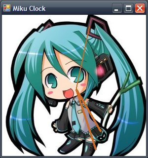

## アナログ時計を作る {#odffd077}

### 概要 {#cb3d5551}
プログラムは次のような感じになる。頭に入れておこう

1. 1秒おきに鳴るタイマーをセット(イベント)
1. タイマーが鳴ると時刻を取得
1. 針を描画
1. 以下繰り返し


### タイマーをセットする {#o4cdcc43}
まずは普通にwindowsアプリケーションを選んで準備しよう。今回は簡単のため300×320の決め打ちでいきます。Form1のプロパティ 配置のところのsizeを300,320にしてください

次はタイマーコントロールを設置します。左のツールボックスからTimerをダブルクリック。Timerコントロールのintervalプロパティを1000に（単位はミリ秒なので）

できたtimer1をダブルクリックすれば

```
private void timer1_Tick(object sender, System.EventArgs e){・・・
```

が勝手に作られているはずです。これが1秒ごとに呼び出されます。本当はいろいろ書かないといけないけどVisual Studioはなんと<strong>全自動</strong>。楽しちゃえ

ここで画面を更新してあげればいいですね。

```
private void timer1_Tick(object sender, System.EventArgs e)
{
   this.Refresh();
}
```


### 時刻を取得 {#w608d52d}
まずはPaintイベントを受け取りましょう。

```
private void Form1_Paint(object sender,  System.Windows.Forms.PaintEventArgs e)
{
}
```

IDEならマウスだけでいけますね。これからは{}の中に書いていきます。

時刻の取得はDateTime.Nowでできます。

```
DateTime dt = DateTime.Now;
```

でdt.Hourで時刻が取り出せます。以下同様

### 描画の準備 {#uc771cc9}
まずキャンパスを準備しましょう。

```
Graphics g = e.Graphics;
g.Clear(Color.White);
```

ここではgがキャンパスです。1行目でキャンパスを取得して、2行目で白で塗りつぶしてます。これで準備完了

### 数学のお勉強 {#tbc6fd54}
今回は簡単のため針は線で描きます。線は始点と終点がわかれば描けます。始点は中心の(150,150)に今回はしましょう。

さて線を書くには座標を求めなければならないわけですが，xyの座標系でぐりんぐりん回る針の座標を求めるのは難しそうです．
そこで[極座標](/docs/三角関数#a3aa1d8b)を使うことにします．
極座標は中心の角度θと長さrで表す座標系です．xとy座標は以下の様に表せます．


x = r\cos\Theta


y = r\sin\Theta


詳しいことは高校の教科書とかわかりやすいと思うよ．

長さrは針の種類ごとに固定です．あとは角度θを時間から求めてあげれば針をどこに描画すればいいかわかりますね．


```
private Point calc_endPoint(int r,int t,int interval)
{
  //r:半径 t:時間 interval|目盛りの間隔
  double cof = 2*Math.PI/interval;

  int x = (int)(r*Math.Sin(cof*t))+center.X;
  int y = (int)(-r*Math.Cos(cof*t))+center.Y;

  return new Point(x,y);
}
```

終点を求める関数はこんな感じ。ｒは長さですね

```
private readonly Point center = new Point(150,150);
```

は適当に用意しといてください

### 針を描画 {#neea2a00}
DrawLineの使い方はMSDNでも見てもらうとしてこんな感じ

```
g.DrawLine(new Pen(Color.Red,3),center,calc_endPoint(100,dt.Hour,12));	//時
g.DrawLine(new Pen(Color.Yellow,3),center,calc_endPoint(130,dt.Minute,60));  //分
g.DrawLine(new Pen(Color.Black,1),center,calc_endPoint(130,dt.Second,60));   //秒
```

色は見やすいように適当に。3や1のところが太さですね。後ろの引数は始点と終点を表してます。

### ソース全景 {#nc62ca20}

```
	//ここは自動で書かれると思います 結構省略してます
	private System.Windows.Forms.Timer timer1;
	
	private void InitializeComponent()
	{
		this.timer1.Enabled = true;
		this.timer1.Interval = 1000;
		this.timer1.Tick += new System.EventHandler(this.timer1_Tick);
	
		this.ClientSize = new System.Drawing.Size(292, 286);
	}
	
	//こっから書いてね
	private readonly Point center = new Point(150,150);
	
	private void Form1_Paint(object sender, System.Windows.Forms.PaintEventArgs e)
	{
		DateTime dt = DateTime.Now;
	
		Graphics g = this.CreateGraphics();
		g.Clear(Color.White);
	
		g.DrawLine(new Pen(Color.Red,3),center,calc_endPoint(100,dt.Hour,12));	//時
		g.DrawLine(new Pen(Color.Yellow,3),center,calc_endPoint(130,dt.Minute,60));  //分
		g.DrawLine(new Pen(Color.Black,1),center,calc_endPoint(130,dt.Second,60));   //秒
	}
	
	
	private Point calc_endPoint(int r,int t,int interval)
	{
		//r:半径 t:時間 interval|目盛りの間隔
		double cof = 2*Math.PI/interval;
	
		int x = (int)(r*Math.Sin(cof*t))+center.X;
		int y = (int)(-r*Math.Cos(cof*t))+center.Y;
	
		return new Point(x,y);
	}
	
	private void timer1_Tick(object sender, System.EventArgs e)
	{
		this.Refresh();
	}
```


## 最後に {#h713559a}
文字盤とかは簡単にできるはずなんで自分で用意してやってみてください。
また針を画像にするなどの工夫をすると楽しいと思います。

## 完成版ソース {#bdaeea2a}

<div class="pukiwiki-ref"></div>


<a href="AnalogClock.zip">AnalogClock.zip</a>


文字盤を初音ミクにしてみました。
