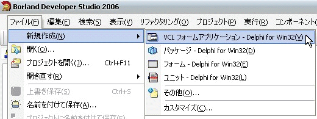
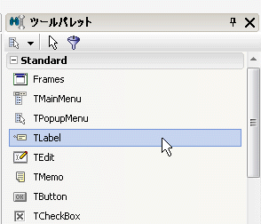
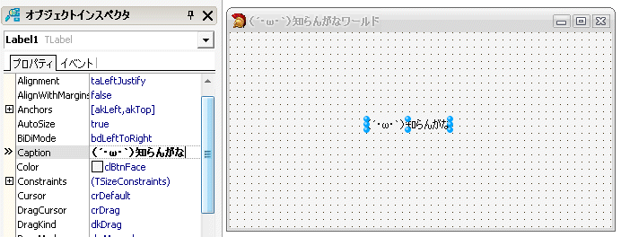

# はじめに {#abf53cab}
DelphiとはPascalをもとに改良された、CodeGearによる言語。<br />
イメージとしてはCとVBとVBを足して3で割った感じ。もちろんオブジェクト指向。<br />
現在ダウンロードできるVBではネイティブコードでDLL,EXEを作成することができないので、<br />
VBを使いやすいと思っているがネイティブコードで開発したいという人は是非試してみてほしい。<br />

## メリット {#baf2d6c4}

- .NETアプリケーションも作成可能<br />
- DirectXも扱える<br />
- 軽い(開発環境じゃなくてビルドされてできたEXEが)<br />
- <del>無料でも十分実用になる</del>
  - 無料版は2011年1月現在、公式には配布されていません([参照](#info))
- C/C++なんかに比べてかなり簡単<br />
- コンパイルがめちゃくちゃ速い<br />

## デメリット {#ycac386b}

- 重い(ビルドされてできたEXEじゃなくて開発環境が)<br />
- ビルドされたファイルサイズがでっかいでっかい(VCLを使った場合)<br />

# インストール(開発環境) {#w13bdd30}
<del>インストールには[Embacadero Developer Network](http://members.codegear.com/)への登録が必要。</del><br />

<del>http://www.codegear.com/jp/downloads/free/turbo </del><br />
<del>よりTurbo Delphi Explorerをダウンロード。</del><br />

<del>ページの"Japanese full prerequisite install"もダウンロードして中にあるものインストール。</del><br />

<del>『[Turbo Explorer Home Page - Downloads](http://www.turboexplorer.com/jp/downloads)』 に「集積Hotfix」ほかダウンロード手順についての説明有り。</del><br />


<dl>
  <dt>「Turbo Explorer」の公開終了</dt>
  <dd></dd>
  <dt><a href="http://www.forest.impress.co.jp/docs/news/20090826_310816.html">窓の杜 - 【NEWS】エンバカデロ、統合開発環境「Delphi 2010」の体験版を公開</a></dt>
  <dd></dd>
</dl>

> 

```
また26日、無償で利用できる開発環境「Turbo Explorer」の公開が終了され、
すでに同社のWebサイトではダウンロードできなくなっている。 
```


<dl>
  <dt><a href="https://forums.codegear.com/thread.jspa?messageID=155201">Embarcadero Discussion Forums: Turbo Delphi 2006 Explorer 配布終了 ...</a></dt>
  <dd></dd>
</dl>


<dl>
  <dt><span id="info">追加情報</span></dt>
  <dd></dd>
</dl>

インストーラだけなら非公式だが[ミラーサイト](http://www.turbomirror.com/)がある。<br />

# Hello World {#v43f62ba}
何もコーディングする必要はない。<br />

<div class="pukiwiki-ref"></div>

ファイル->新規作成->VCLフォームアプリケーション - Delphi for Win32をクリック。<br />
何もないフォームが表示されたはず。<br />
右にあるツールパレット(無い人はCtrl+Alt+Pで表示)からLabelをクリック。<br />

<div class="pukiwiki-ref"></div>

この状態でフォームをクリックすればLabelが貼り付けられる。<br />
左にあるオブジェクトインスペクタのプロパティのCaption項目に表示させたい文字を入力。<br />
フォームを選択した状態でCaptionを編集すればタイトルバーの文字も変えることが出来る。<br />
Label,FormのCaptionプロパティと言う。<br />

<div class="pukiwiki-ref"></div>


上部の緑のボタンをクリックするか、F2キーで実行できる。<br />

[ナッキーの「Turbo Delphiはじめて奮戦記」](http://www.turboexplorer.com/jp/article/33742)は役に立つ気がするので読んでおくといいと思う。<br />

# リンク {#h8b844f2}
ゼロから始めるDelphi講座<br />
http://oto.chu.jp/kujira/text/delphi/zero/index.htm <br />
Delphiはじめの一歩<br />
http://delphi.sakura.vg/index2.html<br />
DelWiki<br />
http://delwiki.info/<br />
フリーのTurbo Delphiで始めるWindowsプログラミング：ITpro<br />
http://itpro.nikkeibp.co.jp/article/COLUMN/20061127/254990/<br />
Turbo Delphiとは？～ダウンロード～インストール～Webブラウザの作成まで画像を交えて解説<br />
[Mr.XRAY &gt; リンク](http://mrxray.on.coocan.jp/Links.htm)<br />
国内外の入門講座、プログラミング解説、資料、サンプルコード、コンポーネントなど各種情報へのリンク<br />
Delphi入門<br />
http://www.w-frontier.com/delphi/<br />
日本Delphi振興会 - Tipsと膨大なリンク集がある<br />
http://delfusa.main.jp/delfusafloor/archive/VA009712_take/delphi/index.htm<br />
Delphi Q & A掲示板<br />
http://hpcgi1.nifty.com/MADIA/DelphiBBS/wwwlng.cgi<br />
