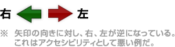

<br />
# HTML {#s1bb8a45}
## HTMLとは {#icb1f2cc}
HTMLはHyper Text Markup Languageの略で、マークアップによってドキュメント構造を表現するものであり、プログラミング言語ではありません。
ですが、Webページを作る際必要不可欠なものであり、CGIで掲示板などを作る際に必要になるため勉強して損はないでしょう。

なんやかんやあって現在WHATWGという団体がHTMLの規格を決めており、HTML Living Standard が最新のHTML規格です。

## 何のためにHTMLは存在するのか？ {#e3f48143}
常識的に考えるだけだと、文書といった場合に重視されるのは「どんな文が書いてあるか」が最大の要素だと思ってしまいがちです。もちろんその文書をわれわれ人間が読むにあたっては当然そのとおりと言えるでしょう。しかしこれを計算機でデータとして扱うに当たって重要なのは、たとえば文章全体の中でどこがタイトルで、どこが要約で、どこが筆者の名前でどこが日付なのか。第一に自然言語を理解できず、第二に処理に厳密性が要求されるコンピュータにとっては、本文よりもこれら「どの文がどういう意味を持つか」ということが重要になってくるのです。

そのような、文章の特定部分に対して意味づけを行う言語のことを、Markup Language(マークアップ言語)と言うのです。「こういう手続きでデータを扱いたい」ということをコンピュータに伝えるのがプログラミング言語なら、「このデータはこういう意味や形をしている」ということをコンピュータに伝えるのがマークアップ言語というわけです。ちなみに頭についているHyper Textとは、われわれが日に5万回はクリックするといわれる「リンク」機能によってつながれた文書のことを言います。結局、HTMLとはウェブ上の文書ファイルに意味や構造の情報を与える手段である、とまとめることができます。

この後の項目で誰かが詳しく説明してくれる予定になっていますが、具体的には

1. 文書がどういった書式で書かれているかを教えてやる
1. 文書のどの部分がリンクを意味しているのかを教えてやる
1. 文書のどの部分が著作者を意味しているのかを教えてやる


などなどの構文があり、これらのおかげでわれわれが愛するFirefox君は文書をわかりやすく表示してくれているというわけです。まあ純粋に意味構造だけじゃ使いづらいので、その特性上ブラウザに処理の指示を与えるとか、文字の色やカタチを指定するとかそういう文もありますので、あんまり硬くなる必要も無いんですけどね。ちなみにOperaを愛しているwiki編集者もここにいます。Operaの速度とレンダリングの忠実さは神に最も近いブラウザを名乗るにふさわしいと思います。Lynxで表示を確認する変人もいます。色んな人がいるので色んな環境で綺麗に見られるHTMLを書きましょう。

## 文書型宣言 {#df4a4c18}

```
<!doctype html>
<title>Test</title>
```

validなHTML文書を書くのはHTML4時代にはややこしい点があったが、HTML5以降は上記の型宣言とtitleタグを入れればそれで一応OKなのだからずいぶん簡単になった。

## 要素とタグ {#ybfd78b0}
HTMLを分かったつもりでいる人は要素とタグの区別がついていません、というか要素という言葉を知りません<br />
要素とは文書の構造を成す塊、タグはその記述手段、といってもよくわからないので例を挙げましょう

```
<p>これは段落です。</p>
```

&lt;p>から</p>までをP要素と呼びます。<p>は開始タグ、</p>は終了タグと呼びます。その間に挟まれているのが内容と呼ばれる物です。<br />
P要素は段落を意味するもので、この場合"これは段落です。"が1つの段落を成していることを意味します<br />
要素は入れ子式に配置されます。が、どの要素にどの要素が入って良いかのルールがあり、それを守らなくては成りません。例えば

```
<p>段落の中に
    <p>段落があってはいけません</p>
</p>
```

は誤りです。P要素の内容にP要素が含まれてはいけないのです（段落の中に段落は通常ありませんしね）<br />
要素によっては終了タグや開始タグ、内容を省略できる物、省略しなくてはいけない物、省略してはいけない物があります。<br />
実はP要素は終了タグが省略できますので先ほどの例は、"段落の中に"が1つの段落として認識され、"段落があってはいけません"が2つめの段落となり、最後に余計な</p>が存在すると考えられます<br />
要素名は大文字で書いても小文字で書いても構いませんが、普通は小文字で統一します。
実際の作業手順として、HTML文書とする（文書インスタンスと成す）文書の構造（ツリー構造<sup id="fnref-1" class="footnote-ref"><a href="#fn-1">*1</a></sup>）に合わせ、マーク付けをする<sup id="fnref-2" class="footnote-ref"><a href="#fn-2">*2</a></sup>、という順序で作業を考えると不思議マークアップやDIV厨<sup id="fnref-3" class="footnote-ref"><a href="#fn-3">*3</a></sup>などに陥る可能性はかなり低くなるのではないかな、と思います。
ついでに『DIV厨』についてさらに言及しておきますと、（大雑把な説明ですが）DIV要素は（匿名ブロック<sup id="fnref-4" class="footnote-ref"><a href="#fn-4">*4</a></sup>は作らず）グループ分け<sup id="fnref-5" class="footnote-ref"><a href="#fn-5">*5</a></sup>を目的に使う、と考えておくとDIV厨にならずに済むのではないでしょうか。

## 属性とは {#m5e3d84f}
属性とは要素に付与される関連特性のことであり、要素ごとにどのような属性が付けられるかは異なる。

```

```

これはIMG要素といってHTML文書中に画像リソースの所在を指定するもので、多くのブラウザの場合画像が文書中に表示される形となる。<br />
画像の所在位置を指定しているのがsrc="./sample.gif"の部分であり、これはIMG要素の属性である。srcを属性名、"./sample.gif"の部分を属性値と呼び、属性は属性名="属性値"という形式で成り立っている。（属性値を省略できる属性もあるが、省略しない方が良い）


## 頻出要素一覧 {#s7a22b09}

<dl>
  <dt>html</dt>
  <dd>必ずDTD宣言の次に1つのみ存在する。開始タグと終了タグが省略できるが通常省略しない。内容としてはHEADとBODYをこの順に1つずつ持つ</dd>
  <dt>head</dt>
  <dd>HTMLの内容として必ず初めに1つだけ存在する。開始タグと終了タグを省略できるが通常省略しない。内容としては必ずTITLEを1つ、BASEを1つ以下持つ他、METAなどを持つことができる</dd>
  <dt>title</dt>
  <dd>HTML文書の中で唯一開始タグも終了タグも内容もその存在自体も省略できない凄い奴。文書のタイトルを内容に記述する。内容には如何なる要素も含まれてはならない。大抵のブラウザではタイトルバーにここの内容が表示される</dd>
  <dt>body</dt>
  <dd>HTMLの内容として必ず2番目に1つだけ存在する。開始タグと終了タグを省略できるが通常省略しない。内容としてはPなどのブロック要素、INS、DEL、SCRIPTを持つことができる。内容は最低でもブロック要素かSCRIPTが1つ以上なくてはならない。大抵のブラウザに表示されるのはこの部分だけである</dd>
  <dt>p</dt>
  <dd>段落。終了タグのみ省略できるが段落の終わりを明確にするためには省略しない方が良い。内容として持てる要素はインライン要素のみである。当然Pをネストしてはいけない</dd>
  <dt>hr</dt>
  <dd>水平線。内容が空でなくてはならず、終了タグを省略するのが普通である</dd>
  <dt>ul</dt>
  <dd>順序無しリスト。タグは省略できず、内容にはLIのみを1つ以上持たなくてはならない。</dd>
  <dt>ol</dt>
  <dd>順序付きリスト。リストの項目に順序（通常正整数番号が1から順に降られる）がある点を除けばULと同様である。</dd>
  <dt>li</dt>
  <dd>リストの項目。OLかULの内容にのみ現れる。終了タグを省略できるが、どこまでが項目かを明確にするためには省略しない方が良い。内容にはブロックレベル要素とインライン要素の両方を持つことができる</dd>
  <dt>em</dt>
  <dd>強調。インライン要素であり、内容として書かれたものを強調する。タグは省略できない。あくまで強調であり、それが太字として表示されるか、斜体として表示されるか、もっと別な形で表示されるかはブラウザ次第である。</dd>
  <dt>strong</dt>
  <dd>EMよりも強い強調。DTD内で%phraseにより展開されるものは全て形式としてはEMと同様のルールを持っており、意味付けのみが異なる。正直一般にはBやIの方がよく使われるが、これらは物理表現要素であり仕様に含まれているものの非推奨であるため、EMとSTRONGを紹介した。</dd>
  <dt>br</dt>
  <dd>(強制)改行。内容は空でなくてはならず、終了タグは省略できる。あまり乱用すべきものでは無いが、掲示板を作る上ではほぼ必須か。</dd>
  <dt>img</dt>
  <dd>画像リソースの指定。と言った形式で用いられることが多い。src属性の値には画像リソースの所在、平たくいえば画像までの絶対パスか相対パスを書かなくてはならない。この属性は必ず記述しなくてはならない。alt属性の値には代替テキストを記述する。代替テキストは画像が表示できない（もしくはしないように設定されている）環境で、画像の代わりに使われるテキスト。だいたいそんな感じ。これは盲目のユーザや何らかの事情で画像が表示できない、あるいはされない場合に対処するための物であり、この属性もsrc属性同様必須である。widthとheightは必須では無いが大抵のブラウザでは画像は埋め込まれる形式で表示されるので幅と高さを指定するのはマナーである。</dd>
</dl>


それからBODY要素の中で使われる要素は大きく分けて「ブロックレベル要素」と「インライン要素」<sup id="fnref-6" class="footnote-ref"><a href="#fn-6">*6</a></sup>があり、それぞれどのように使われるのか理解しておく必要があります。

# CSS {#p8f65b2d}

## CSSとは何か {#dfb2a24a}
CSSとはCascading Style Sheetの略で、無理矢理和訳すると「重ね合わせ可能な表現形式の一覧」ということになります。「重ね合わせ可能」という部分はCSSについて学ばないと分からないので、当面は「表現形式の一覧」、つまりスタイルシートという部分を意識していただければ理解には差し支えありません。スタイルシートっていったい何でしょうか？

HTMLの項目を見ていただいたとき、「HTMLは文書の構造を示すべきであって、デザインを表現すべきではない」という内容の文があったかと思います（なくてもそのうち誰かが書くに決まってます）。HTMLがコンピュータに意味情報を与える物だという話を理解していただければそれは当然のことで、人が主観で感じる色やカタチの情報をコンピュータに与えるべきではないからです。「そんなん人が読むから関係ないし」とか言う方には、具体例としてよく挙げられるのが検索エンジンです。Googleを筆頭に、今現在活躍している「ロボット型」と呼ばれる検索エンジンは、プログラムが自動的にHTML文書を解釈することで検索用のデータベースを作成しています。そのため、解釈しにくいデータの入り交じったHTMLでは、正常に検索結果に反映されないという事態もあり得ます。また、製作過程としても「デザインする」という作業と「文書構造を分析する」という作業がほとんど違う物であるということは直感的にも理解いただけることでしょう。

さてここで生じる疑問は、「じゃあどうやってデザインしろっつーんだよｗｗｗｗｗバーロｗｗｗｗｗ」という一言に他ならないでしょう。その手段として現在一般的なのが、スタイルシートなのです。スタイルシートには、「この種類のタグにはこういう色や形を付けておいて」という情報を羅列したテキストのことで、これをHTMLとは別に用意してつなぎ合わせてやることで、「文書構造」と「デザイン」をほぼ完全に分離することができるのです。

具体的にCSSを使うことで得られるメリットは、

1. ぶっちゃけHTMLが読みやすくなる
1. 単一のCSSファイルを使い回し、デザインを気にせずに複数のHTML文書を記述できる
1. 複数のCSSファイルを使って、気分次第や閲覧者の必要に応じて簡単にデザインを差し替えることができる
1. 同じ原理で、印刷スタイルとブラウザスタイルを別にすることができる
1. 通常のHTMLでは表現できないデザインが可能である
1. ユーザースタイルシートが使用でき、アクセシビリティに配慮されたサイトを作れる


などなどそれなりにありますので、是非ともHTML+CSSで素敵なウェブアプリケーションを構築してください。

# 雑学 {#ic6f84d1}
## URI {#xa35fda8}
URIという記述を見かけたことがあるかもしれませんが、これはURLの誤りではありません。URIはインターネット上のリソースの位置を示すもので、URLはその一部なのです。もともとURL、Uniform Resource Locatorは「モノの場所を示す方式」と和訳することができ、その名のとおりHTML文書の存在場所を示すものとして規定されました。しかし場所だけでなく、あらゆる「モノの識別のための共通方式」にまで拡張してやろう、として出てきた考え方がURI、Uniform Resource Identifierなのです。これは和訳すれば「モノの識別をする方式」となり、概念的により広いものになっていることがわかると思います。

さて、こういうRFCを書くお偉方は、上記のような抽象的かつ難解な表現が大好きですが、別に難しい話ではありません。「スキーム:識別子」つー書き方を標準にしようぜ、っていうそんだけの宣言です。スキームというのは、「何の識別子」かを意味する英数字で、このスキームの種類によって識別子の書き方は変わって来ます。たとえばHTML文書を示すためのhttpスキームでは、//をルートとしてサーバー名、ポート番号、ファイル名などを記述することが許可されています。

## スキーム {#w05b55c2}
よくhttp://～とかftp://～とか書かれていますが、このhttpの部分はプロトコルではなくスキームと呼びます<br />
勿論httpの意味している所はHyper Text Transfer Protocolですが、この部分にかかれていること=使用プロトコル、という意味ではありません<br />
よくこの反例として挙げられるのがmailto:です。これはスキームですがプロトコルではありませんね

## SGML {#x43b6da3}
HTMLはSGMLのアプリケーションです。SGMLはマークアップ言語を定義するためのメタ言語です（wikipediaより）この場合のアプリケーションはアプリケーションソフトという意味ではなく、適用という意味です。

## スタイルシート {#tf9de621}
CSSはスタイルシートの一種であり、CSS=スタイルシートではありません。CSS以外のスタイルシートを扱うブラウザが皆無に等しいだけなのです

# 環境 {#dc4c6b23}
## ブラウザ {#x079aec0}
CSSを紹介していて残念ですが、CSSではデザインを統一することができません。それはバグや<del>意図的に</del>仕様を無視するブラウザが存在するためです。ですから表示の確認にはできるだけ多くのブラウザを使うことが望ましいです。

- Microsoft Edge (Microsoft謹製)
- FireFox (https://www.mozilla.org/ja-jp/firefox/new/ よりダウンロード。エンジンはMozilla系)
- Google Chrome (https://www.google.com/intl/ja_jp/chrome/ よりダウンロード。)
- Opera (http://jp.opera.com/ よりダウンロード。独自エンジンのIE拡張に一部対応)
- Safari (http://www.apple.com/jp/safari/ よりダウンロード。WebKit系エンジン)
- Konqueror (WebKit系エンジンのベースとなったKHTMLエンジン)
- Lynx (テキストブラウザ)
- 家庭用ゲーム機


エンジンでブラウザの特徴がでますです。

しかしすべての環境を再現するのは難しいでしょう。とくにMacとか。ですので[browsershots](https://browsershots.org/)をおすすめします。このサイトは各環境のSSをとってくれる便利なやつです。ただしいつも夏休みのディズニーランドくらい行列ができています。気長に待ちましょう。使い方は[GIGAZINE](https://gigazine.net/news/20060908_browsershots/)を参照のこと。

## 確認環境 {#x34c4531}
2010年代まではブラウザごとに描画がまちまちで対応に苦労した。（主にInternet Explorerのせいで。シェアを持っていただけに大変悪質な存在だった。）しかしこの困難はもはや無くなったと感じられる。<br />
とはいえ試験的な機能への対応差はある。[MDN](https://developer.mozilla.org/ja/)や[Can I use](https://caniuse.com/)で状況を確認しよう。

## 編集環境 {#yd7bd4fe}
PerlやPHPで扱う場合にはそれ用のエディタを使って編集してください。HTML文書を単独で扱う場合は適当なテキストエディタがあると良いでしょう。エディタ開発者がHTML分かってない場合もあるので注意。

Mac OS Xの場合、無料で付いてくるXcode(Apple謹製)だとか、Coda(シェアウェア)とか便利。

# アクセシビリティ {#zbd63ec3}
Accessibilityとは近づきやすさという意味の単語です。webの世界では情報へのアクセスのしやすさを言います。現在のネットはコンピュータおたくの為の物ではなくなってしまいました。ネットには可愛らしい幼女から老人まで多種多様な人がアクセスしています。中には色弱の方もいるでしょう。もしかしたらマウスは使えないかもしれません。携帯端末でJavascriptは動作しないかも知れません。それらの人にもきちんと情報を伝えられるように考える、それがアクセシビリティの考え方です。

<dl>
  <dt>目に優しい背景色</dt>
  <dd>たまに黄色背景のページに出会うことがあります。何考えてるのかわかりませんが、もう二度とお客さんは来てくれないでしょう。彩度の高い背景色は大方目に悪いのです。</dd>
  <dt>色弱の人に優しい背景色</dt>
  <dd>色弱の人はある種の色が区別できません。それがどのような色なのかは様々ですが、日本には赤色が見えにくい人が多いですね。グレースケール化しても読めるように文字と背景のコントラストを上げておくのが良いでしょう。</dd>
  <dt>ハイパーリンクはわかりやすく</dt>
  <dd>ハイパーリンクの基本は青文字、下線です。デザインを変えることもありですが、リンクであることがわかるようにアイコンを付けたりわかりやすくする必要があります。またリンクは<a href="http://www.2ch.net">ここ</a>とかではなく<a href="http://www.2ch.net">2ch</a>のようにリンクしましょう。</dd>
  <dt>Javascriptは動作しない時のことも考える</dt>
  <dd>たまにJs切っていると真っ白なページに出会うことがあります。Jsは意図して切っている人も多いので切っていても最低限の情報は伝えられるようにしておきましょう。</dd>
</dl>


強制をするつもりはありませんが、オナニーで満足していては上にはいけないと思います。

<div class="pukiwiki-ref"></div>


```
　　　　　　 ／＼
　　　　　／　　　＼
　　　　　￣|　　|￣
　　　　＿__|　　|＿＿
　 　／　⌒　　　⌒ ::: ＼ 　　|＼
　 　|　（●）,　、（●）、　￣￣　 ＼
　 　|　　,,ノ(、_, )ヽ、,, 　 　左を見ろ>　　　　　　　　　　　　　　　　こっちは右だバカ！
　 　|　　｀ﾄｪｪｪｪｲ' 　 .:::::＿＿　 .／
　　　＼　｀ニニ´　 .:::／ 　　 |／
　l_!!! ,､ ,..-ヽｰ'',,.. ' ノ｀丶--'ー--､ -―--､　+　+　　　+
　| ! !_!|i::::::::::｀´ｰ''´:::::::::::::::::::|:::::::::::::::::::::,..､::｀ヽ　　+　　　　　+
　.! ',　,|!::::::::::::::::::::::::::::::::::::::::::ヽ／---‐'´｀＼::::＼　　　+
　　!､_,ｲ:::ヽ::::::::::::::::::::::├┤:::／::|　　　　 　　 ＼:::ヽ､_
　　',::::::',::::::|ヽ::::::::::::::::::::::::::::/:::::::l　　　　　　　　 ヽ'　　ヽ
　　 ',:::::::',::::!　ヽ:::::::::::::::::::::::::::::::::,!　　　　　　　 　 ヽ __ノ
　　　',:::::::::::|　　 ',::::::::::::::::::::::::::::/|
　　　 ヽ_ ノ　　　ヽ::::::::::::::::::::::::::::::
```

これも大変悪い例と言えるでしょう。

# 吉野家のHTML {#z394b904}

```
そんな事より１よ、ちょいと聞いてくれよ。Wikiとあんま関係ないけどさ。
このあいだ、Webサイト見たんです。Webサイト。
そしたらなんかレイアウトがめちゃくちゃで見られないんです。
で、よく見たらなんかtableがあって、margin=0、とか書いてあるんです。
もうね、アホかと。馬鹿かと。
お前らな、tableレイアウト如きで普段書かないカラム書いてんじゃねーよ、ボケが。
tableだよ、table。
なんかfontとかもあるし。物理表現要素でHTMLか。おめでてーな。
よーし文字が目立っちゃうぞー、とか言ってるの。もう見てらんない。
お前らな、css教えてやるからそのサイト閉鎖しろと。
HTMLってのはな、もっと殺伐としてるべきなんだよ。
要素をタグと間違った奴といつ喧嘩が始まってもおかしくない、
刺すか刺されるか、そんな雰囲気がいいんじゃねーか。Tranditionalは、すっこんでろ。
で、やっと座れたかと思ったら、隣の奴が、ホームページビルダー、とか言ってるんです。
そこでまたぶち切れですよ。
あのな、ホームページビルダーなんてきょうび流行んねーんだよ。ボケが。
得意げな顔して何が、ホームページビルダー、だ。
お前は本当にホームページビルダーを使いたいのかと問いたい。問い詰めたい。小１時間問い詰めたい。
お前、ホームページって言いたいだけちゃうんかと。
HTML通の俺から言わせてもらえば今、HTML通の間での最新流行はやっぱり、
メモ帳、これだね。
スタート->アクセサリ->メモ帳。これが通の使い方。
メモ帳ってのはUTF-8も読み込める。そん代わり改行コードLFがだめ。これ。
で、それにLynx。これ最強。
しかしこれを使うと次からCtrl+Zで1個しか戻れないという危険も伴う、諸刃の剣。
素人にはお薦め出来ない。
まあお前、１は、DreamWeaverでも使ってなさいってこった。
```


# 参考リンク {#references}

<dl>
  <dt><a href="http://www.w3.org/TR/">W3C Technical Reports and Publications</a></dt>
  <dd></dd>
</dl>

W3Cの仕様書

<dl>
  <dt><a href="http://www.w3.org/Consortium/Translation/Japanese.html.ja.jis">W3C - W3Cの仕様書等の文書の日本語訳集</a></dt>
  <dd></dd>
</dl>

邦訳集

<dl>
  <dt><a href="http://www.y-adagio.com/public/standards/css1/toc.htm">CSS1 Table of Contents</a></dt>
  <dd>CSS1(TR)仕様書邦訳、Y-ADAGIO.com</dd>
  <dt><a href="http://www.y-adagio.com/public/standards/tr_css2/toc.html">Cascading Style Sheets, Level 2</a></dt>
  <dd>CSS2(TR)仕様書邦訳、Y-ADAGIO.com</dd>
  <dt><a href="http://momdo.s35.xrea.com/web-html-test/CSS3-ja/index.html">CSS3の日本語訳集 - 血統の森 web実験小屋</a></dt>
  <dd>日本語訳集の「状態」を分かりやすく分類、表記。</dd>
  <dt><a href="http://www.fliedlice.com/maccaws/">Web標準導入キット - maccaws.org</a></dt>
  <dd></dd>
</dl>

サイトを持つなら知っておくべきWeb標準の知識：Web標準手引き

<dl>
  <dt><a href="http://az-store.nrym.org/reproduce/mynotes/lecture/">脱初心者をめざす人のためのホームページ作成講座</a></dt>
  <dd></dd>
</dl>

初心者向け解説

<dl>
  <dt><a href="http://az-store.nrym.org/reproduce/mynotes/lecture/misc/links">ウェブページ制作関連リンク -- 脱初心者をめざす人のためのホームページ作成講座</a></dt>
  <dd></dd>
</dl>

参考リンク：リファレンス、解説サイト、ツール類

<dl>
  <dt><a href="http://hp.vector.co.jp/authors/VA022006/links.html">附録：ウェブデザイン關聯リンク集 - HTML覺書とCSS2リファレンス</a></dt>
  <dd></dd>
</dl>

ウェブ技術を学習する人に参考にして貰いたい，良質なリソースの紹介

<dl>
  <dt><a href="http://memo.imagines.jp/">Web系メモ</a></dt>
  <dd></dd>
</dl>

参考リンク：リファレンス、解説サイト、ツール類、Script各種

<dl>
  <dt><a href="http://html5.jp/">HTML5.JP - 次世代HTML標準 HTML5情報サイト</a></dt>
  <dd></dd>
</dl>

HTML5の仕様に関するトピックを紹介。<strong>注意</strong>：HTML5はまだW3CやWHATWGで<strong>策定中</strong>。


<dl>
  <dt><a href="http://www.scollabo.com/banban/lectur/ht.html">WebとHTML/初心者のためのホームページ作り</a></dt>
  <dd></dd>
</dl>

『Webの理念』などは基礎知識として押さえておきましょう。 - 「ValidなHTMLを書く」のは誰のため？


<dl>
  <dt><a href="http://bakera.jp/w2cwg">W2Cマークアップエンジニア・ワーキンググループ 「マークアップエンジニアが知っておきたい3つの脆弱性」 - bakera.jp</a></dt>
  <dd></dd>
</dl>

プレゼンテーション資料公開 - 「ValidなHTMLを書く」のは誰のため？

<dl>
  <dt><a href="http://bakera.jp/ebi/topic/3916">マークアップエンジニアが知っておきたい3つの脆弱性:補足 - 水無月ばけらのえび日記</a></dt>
  <dd></dd>
</dl>

&amp;の扱いについて（文字参照の説明での抜け）ほか


<dl>
  <dt>セマンティック・ウェブ</dt>
  <dd></dd>
</dl>

[メタ情報とセマンティック・ウェブ - The Web KANZAKI](http://www.kanzaki.com/docs/sw/) , <br />
[セマンティックweb - Google 検索](http://www.google.co.jp/search?q=%E3%82%BB%E3%83%9E%E3%83%B3%E3%83%86%E3%82%A3%E3%83%83%E3%82%AFweb&lr=lang_ja)


<div class="footnotes">
<hr />
<ol>
<li id="fn-1">参考：[親要素と子要素 - The Web KANZAKI](http://www.kanzaki.com/docs/html/htminfo11.html#model) 、 [要素の親子関係 - 初心者のためのホームページ作り/Web for beginner ホームページ作成支援](http://www.scollabo.com/banban/lectur/ht6.html) <a href="#fnref-1" class="footnote-backref">&#8617;</a></li>
<li id="fn-2">参考：[文書構造と動的なWebのアクセシビリティ | Web標準Blog | ミツエーリンクス](http://standards.mitsue.co.jp/archives/001432.html) 、 [ウェブを作るにあたって気をつけていること « vanillate](http://vanillate.org/archives/105) <a href="#fnref-2" class="footnote-backref">&#8617;</a></li>
<li id="fn-3">参考：[From DFJ：DIV病(InternetArchive)](http://web.archive.org/web/20060901043410/http://www.fromdfj.net/html/divsyndrome.html) 、 [divを使うということ - Personnel](http://members.jcom.home.ne.jp/jintrick/Personal/css_div.html) 、 [ADP: えふえーきゅー](http://adp.daa.jp/archives/000474.html) 、 [覚え書き@kazuhi.to: div厨](http://kidachi.kazuhi.to/blog/archives/001172.html) <a href="#fnref-3" class="footnote-backref">&#8617;</a></li>
<li id="fn-4">参考：[匿名ブロック | 鳩丸ぐろっさり (用語集)](http://bakera.jp/glossary/%E5%8C%BF%E5%90%8D%E3%83%96%E3%83%AD%E3%83%83%E3%82%AF) 、 [匿名ブロックボックス - ボックスの種類 - CSS Dencitie](http://www6.plala.or.jp/go_west/nextcss/ref/article/box_var.htm#ano) <a href="#fnref-4" class="footnote-backref">&#8617;</a></li>
<li id="fn-5">参考：[グループ化: div要素とspan要素 - HTML覺書](http://hp.vector.co.jp/authors/VA022006/html/global.html#grouping) <a href="#fnref-5" class="footnote-backref">&#8617;</a></li>
<li id="fn-6">参考：[ブロックレベル要素とインライン要素 - The Web KANZAKI](http://www.kanzaki.com/docs/html/element-level.html) 、 [ブロック要素 XHTML HTML辞典 - W3G](http://w3g.jp/xhtml/dic/block_element) <a href="#fnref-6" class="footnote-backref">&#8617;</a></li>
</ol>
</div>
