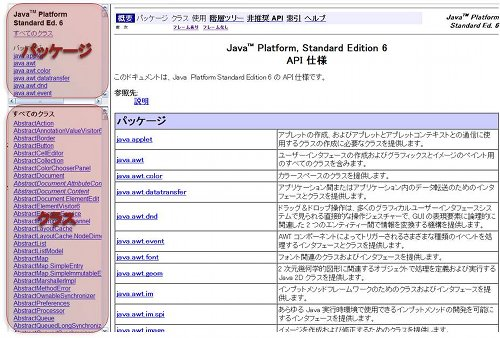
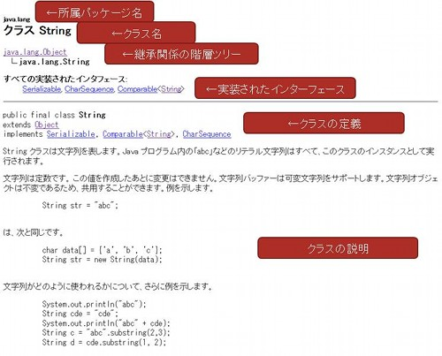

# Javadocの読み方 {#u64e65a8}

## はじめに {#k01af436}
初心者がある程度のプログラムを書けるようになったらつまずくのが標準ライブラリの調べ方ではないでしょうか？初心者向けの本には「調べてみましょう」くらいの記載しか無かったり，上級者向けの本では「知ってて当たり前だろ？なめてんの？」みたいなものばかりです．

そこでこのページではJavaの標準ライブラリを調べていく方法を書いていこうと思います．目指せ脱初心者！

## Javadocとはなにか？ {#ucd13f48}
ソフトウェア開発においては，プログラミングと同じくらい文書作成は重要になります．そこでJavaを作ったSunではJavaのソースコードに埋め込んだコメントをHtml形式に整形してくれるツールを提供しています．これが<strong>Javadoc</strong>です．Javadocで生成されたHtml文書をjavadocとも言います．

Javaを作った人たちも標準ライブラリの使い方を示したJavadocを作ってくれて公開しています．標準ライブラリの使い方を調べるときはこのJavadocを見ればいいわけです．

## Java Platform, Standard Edition 6 API 仕様 {#h394ccb1}
最新のJava標準ライブラリのJavadocは[http://java.sun.com/javase/ja/6/docs/ja/api/index.html](http://java.sun.com/javase/ja/6/docs/ja/api/index.html)にあります(2009/06/11現在)．EclipseからだとJavadocを見たいクラス名やメソッド名にカーソルを合わせて<em>Shift+F2</em>で参照できます．

## Javadocの見方 {#l04800d0}
まず，各フレームについて説明しましょう．



### パッケージ {#yaec0912}
左上はパッケージが表示されています．パッケージはフォルダのようなものです．ライブラリはパッケージによって種類ごとに分けられています．最初はすべてのクラスが選択されていますので真ん中のフレームには各パッケージの説明が書かれています．読んでみるとどういった種類のライブラリがあるかわかるでしょう．

### クラス {#v1f5957d}
左下は選択したパッケージに所属するクラスの一覧が表示されます．最初は標準ライブラリにあるすべてのクラスが表示されています．めまいがするような数があります．

## クラスの説明の見方 {#e31f70ec}
さて実際にクラスのページを見ていきたいと思います．ここでは皆さんがよく使ったことのあるStringクラスを見てみましょう．Stringはjava.langパッケージに所属しています．探してみましょう．

見つかったでしょうか？ まずは上から順番に何が書いてあるか説明します．



### 所属パッケージ名 {#s7205dfa}
ここにはクラスが所属しているパッケージ名が表示されています．Stringはjava.langパッケージに所属しています． langはlnguageの略で，Java言語にとって重要なクラスが所属しています．

### クラス名 {#wda77239}
クラスの名前です．

### 継承関係の階層ツリー {#w958fc64}
クラスは他のクラスを継承していくことができます．いわゆるextendsです．この階層ツリーには継承関係を表すツリーが表示されます．これによるとStringはjava.lang.Objectクラスを継承していることがわかります．

### 実装されたインターフェース {#g1fc03bb}
ここには実装されたインターフェースが表示されます．つまりimplements．
StringはSerializable, CharSequence, Comparable<String>を実装していることがわかります．このインターフェースがどんなものかは今はあまり気にしなくていいでしょう．

Comparable<String>は<>がついてなんか見慣れない形ですがこれは<strong>ジェネリクス</strong>と呼ばれる機能のことです．ちょっと難しいのでジェネリクスを習うまでは変わった名前だなくらいでいいと思います．

### クラスの定義 {#c4b13613}
ソースに書かれたクラスの定義そのまんまですね．

### クラスの説明 {#beefc3b9}
クラスについての説明がここに書かれます．使うときにの注意事項はだいたいここに書かれていますのでよく読んでおきましょう．

これを読むと

- ""でくくられた文字はString型のオブジェクトになる．
- String型は一回作ったら中身を変更することはできない．
- ほんとは+演算子では数値しか足せないけど，Javaは特別に文字連結できちゃうよ！


とかいろいろ書いてあります．サンプルコードもありますね．

### 導入されたバージョン {#g2e6202d}
あんまり気にする必要はありませんが，このクラスが導入された時のバージョンが書いてあります．最新のバージョンはJDK1.6です．(2009/06/11現在)

### 関連項目 {#t6654b10}
関連する項目が書かれています．特にStringBuilderなんかは関係してると思いますがそれはまた別のお話．

### フィールドの概要 {#u6465af8}
ここにはPublicなフィールドが表示されます．
StringにはCASE_INSENSITIVE_ORDERというフィールドが定義されています．Case Insensitiveは大文字小文字を区別しない，orderは順番という意味です．
なので大文字小文字を区別しないで順番に並べるときにつかうなんかって事になります．

### コンストラクタの概要 {#w5576020}
コンストラクタはクラスからインスタンスを生成するときに呼ばれるメソッドの事ですね．カタカナばかりですが，この辺の用語はきちんと復習しておきましょう．つまり

```
String str = new String(); ←これのこと
```


オーバーロードによって引数が違うコンストラクタを複数作ることができます．見てみるとStringには15個ものコンストラクタがある事がわかります．

<strong>推奨されていません。</strong>と書かれているコンストラクタはマジで推奨されていません．つまり使ってはいけません．昔使われていたものです．代わりにこのメソッド使いなさいってことが書いてあるのでこれに従いましょう．

### メソッドの概要 {#p1d800d3}
クラスが持っているメソッドの概要が表示されます．左側に型，右側にメソッド名と引数，簡単な解説が表示されます．

### ～から継承されたメソッド {#hb8ba665}
スーパークラスが持っているメソッドはここに表示されます．

### 詳細 {#x4119bb1}
さてここまでは概要でしたので解説もさらっとしたものでしたが，青くなっているリンクをクリックすると詳細が書かれた場所に飛ぶことができます．ここではchar charAt(int index)メソッドを使って解説していきたいと思います．

まずメソッドの説明が書かれています．このメソッドは具体的にどんな動作をしてくれるかが書かれています．chatAtには

```
指定されたインデックス位置にある char 値を返します
```

と書かれているので指定した位置の文字を取得することのできるメソッドのようです．
charは1文字だけ格納できる型でしたよね．

次は定義です．これはインターフェースを実装した場合に表示されます．ぶっちゃけここの情報を見たことはないです．

パラメータは引数のことです．引数としてどんなものを与えればいいかが書かれています．char 値のインデックスとか日本語おかしい気がしますがキニシナイ．

戻り値はメソッドを実行したときに返される値がどんなものであるか書かれています．

例外はどんな状況でどんな例外が発生するか書かれています．引数indexが負か文字列の長さよりも大きい場合にIndexOutOfBoundsExceptionを発生させると書いてあります．

基本的にこれくらい読めれば十分です．次は知らないクラスを実際に探して使ってみましょう．

## 知らないクラスを探して，使ってみる． {#m12bde3f}
なんかこんなライブラリーないかなーと思ったときはGoogle先生に聞いちゃうのが早かったりしますが，ここはJavadocから探してみたいと思います．

さてここでは簡単なアプリを作ってもらいたいと思います．テーマは<strong>物理乱数の取得です</strong>．
乱数はjava.util.Randomクラスで取得できるよと思われるかもしれませんが，Randomクラスで得られる乱数は疑似乱数を呼ばれる乱数で数式で計算した<strong>乱数っぽい何か</strong>です．

将来，もしかしたらサイコロで振ったような乱数が欲しくなるかもしれません．そういった奇特な人のために統計数理研究所は乱数取得サービスを提供しています．[http://random.ism.ac.jp/random/index.php](http://random.ism.ac.jp/random/index.php)
ためしに物理乱数(integer型)をダウンロードしてみましょう．テキストファイルで乱数だけが書かれたファイルが落ちてきたと思います．今回はコレをJavaプログラムで取得します．

### インターネットからデータを取得する {#zec1cdd0}
まずはネットからデータを取ってくるようなクラスを探しましょう．パッケージの説明を眺めてそれらしいパッケージがないか探してみてください．

おっとjava.netというそれらしいパッケージが見つかりました．説明には

```
ネットワーク対応アプリケーションを実装するためのクラスを提供します。
```

と書いてあるのでこれっぽいですね．クリックしてみます．

インターフェース，クラス，例外の概要が書いてありますが，今回はクラスを探しましょう．
URLConnectionやURLといったクラスが関係ありそうです．URLはよく知っているのでURLクラスを見てみましょう．

### URLオブジェクトを生成する {#aa0a6d13}
サーバーにアクセスするためにはサーバーの位置を示すURLが必要ですからまずはURLクラスのインスタンスを生成してみましょう．
先ほどのテキストファイルのURLは http://random.ism.ac.jp/random/download.php?file=prn_int.txt です．
インスタンスを生成するためにはまず，コンストラクタを調べましょう．一番上の<em>URL(String spec)</em>が引数も少なくてお手軽そうです．これを使いましょう．

```
try {
	URL url = new URL("http://random.ism.ac.jp/random/download.php?file=prn_int.txt");
}
catch (MalformedURLException e) {
	e.printStackTrace();
}
```

<em>URL(String spec)</em>コンストラクタは詳細を読むと例外MalformedURLExceptionを出すと書いてあります．なのでtry-catchが必要です．

### URLにアクセスして中身を取得する(失敗) {#m7122c6b}
さてURL接続して中身を取ってくるわけですが，URLクラスなになんかいいメソッドがないか探してみましょう．
するとすぐにgetContent()というメソッドが見つかります．説明には

```
この URL のコンテンツを取得します。
```

とあるのでなんかうまくいきそうなよかんです．早速以下のようなコードを書いてみました．

```
try {
	URL url = new URL("http://random.ism.ac.jp/random/download.php?file=prn_int.txt");
	System.out.println(url.getContent());
}
catch (MalformedURLException e) {
	e.printStackTrace();
}
catch (IOException e) {
	e.printStackTrace();
}
```

getContent()メソッドは詳細で読むとIOExceptionを出します．なのでcatch節を追加してやる必要があります．

さてこのまま実行すると

```
sun.net.www.protocol.http.HttpURLConnection$HttpInputStream@12ac982
```

私の環境では以上のようなメッセージが出力されました．どうやらgetContent()メソッドで帰ってくるのは単純な文字列ではないようです．残念．

### 指定したURLに接続する {#p74eb71c}
気を取り直してgetContent()メソッドの説明を読むと

```
この URL のコンテンツを取得します。このメソッドは次のメソッドの短縮形です。
openConnection().getContent()
```

と書かれています．一つ上のopenStream()メソッドもopenConnection()メソッドを省略するだけのものらしいことがわかります．

openConnection()メソッドになにかありそうなので見てみましょう．説明には

```
URL が参照するリモートオブジェクトへの接続を表す URLConnection オブジェクトを返します。
この URL のプロトコルハンドラの openConnection メソッドを呼び出すたびに、新しい接続が開かれます。 
```

とあるのでこれを呼び出せば指定したURLに接続してくれるっぽいですね．戻り値は<em>URLConnection</em>クラスになっています．
URLConnectionクラスにはいろいろと便利なコードがありそうなので見てみましょう．
さっそく呼び出すコードを書きましょう．さっきのコードに追加してみます．

```
URLConnection connect = url.openConnection();
```


### 接続からデータを読み込む {#xa4a3cdb}
<em>URLConnection</em>クラスになんかよさそうな物がないか探しますが，そのものズバリのものはないようです．
もうちょっとよく見てみましょう．<em>getInputStream()</em>というメソッドがありました．このメソッドの戻り値はInputStreamのようです．詳細な説明をよく見てみましょう．

```
この接続からの入力を受け取る入力ストリームを返します。 
```

なんかこれで取れそうな気はするのですが，いったいInputStreamとはなんでしょうか？

### ストリームってなに？ {#p736d0e6}
ストリームとはデータの入出力を抽象化するものです．
プログラミングにおいてデータの入出力は頻繁に行われます．画面，キーボード，ファイル，プリンタ，ネットワーク，etc...
ストリームはこれらを同じ方法で扱うようにする方法です．

画面に文字を出力する方法を思い出してください．

```
System.out.println(line);
```

このコードを書くと思います．JavadocでSystem.out(Systemはjava.langパッケージ)を調べてみると

```
static PrintStream out 「標準」出力ストリームです。
```

とかかれています．つまり画面に文字を出力するときもストリームを使っていることになります．

ネットワークも同じでファイルやキーボードの入力と同じように取得することができるのです．
[プログラミング言語/Java](/docs/プログラミング言語/Java)で，キーボードの入力を読み取る方法がありましたが，それとほとんど一緒です．

私は以下のようにしています．

```
BufferedReader in = new BufferedReader(new InputStreamReader(～InputStream()));
String line = null;
while((line = in.readLine()) != null) {
	System.out.println(line);
}
```

これだけで，キーボード，ファイル，ネットワークなんでも読めるので覚えておくといいです．

### データを読み込む {#ld3b6510}
上のコードを合わせて最終的に以下のようになりました．


```
import java.io.BufferedReader;
import java.io.IOException;
import java.io.InputStreamReader;
import java.net.MalformedURLException;
import java.net.URL;
import java.net.URLConnection;
 
public class PhysicsRandom {
	public static void main(String[] args) {
		try {
			URL url = new URL("http://random.ism.ac.jp/random/download.php?file=prn_int.txt");
			URLConnection connect = url.openConnection();
			BufferedReader in = new BufferedReader(new InputStreamReader(connect.getInputStream()));
			String line = "";
			while((line = in.readLine()) != null) {
				System.out.println(line);
			}
		}
		catch (MalformedURLException e) {
			e.printStackTrace();
		}
		catch (IOException e) {
			e.printStackTrace();
		}
	}
}
```


## 最後に {#p1221de7}
だいぶ駆け足で来ましたが，javadocの探し方のイメージがつかんでいただけたでしょうか？
Javadocは専門用語であふれていますので正確に理解するには用語の理解が必要です．
あとは慣れです．できるだけJavadocを引くようにするとすぐに読めるようになるでしょう．

Good luck!
