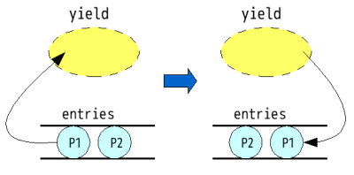

# GameMasterクラス {#dab7af55}

その名の通り、しりとりゲームを管理するクラス。

まずはinitialize()メソッドを見てみよう。説明しておくと、
クラスからnewされたインスタンスは、このメソッドによって初期化される。

## リスト1-1 GameMaster#initialize {#tf0c1cd6}

```
def initialize
  @dictionary = []
  @players = []
  @answer_log = [] #assoc list ... [word, player_id]
  @before = nil
end
```


`@'というプレフィクス付きの変数がインスタンス変数だ。

空のブランケット(`[]')は長さゼロの配列を生成するので、
@dictionary, @players, @answer_logは配列である。

@answer_log脇にコメントがあるが、これは@answer_logを、


```
0 | "vip"    | "わたし"
1 | "poison" | "あなた"
2 | "noodle" | "わたし"
3 | "enjoy"  | "あなた"
　　　　.
　　　　.
　　　　.
```


といった形式で保存しておくということだ。
配列の入れ子による二次元配列(もどき)である。

宣言されていない(=まだ一度も代入されていない)インスタンス変数は、
参照するとnilであるが、
「始めはnilである値だ」ということを明示するために@beforeに
nilを代入している。


<br />


次に、インタフェース(メソッド)を見てみる。
だいたい呼ばれる順に見ていこう。


## リスト1-2 GameMaster#dictionary_load {#de212032}

```
 def dictionary_load(f)
   f.each do |line|
     line.strip!
     @dictionary.push line.downcase if /\A\w+\Z/ =~ line
   end
 end
```


名前まんまのメソッド。引数のfはIOオブジェクトを期待している。

毎行読んで、前後の空白や改行をとっぱらって、単語らしき文字列であれば
@dictionaryに追加していく。その際、紛らわしさをなくすためにString#downcase
によって小文字のみにしている。


## リスト1-3 GameMaster#entry {#p9ec995c}

```
 def entry(pl)
   pl.dictionary = @dictionary
   pl.game_master = self
   @players.push pl
 end
```


plはPlayerクラスを期待。といっても、実際はManualPlayerかAutoPlayerなのだが。

Playerのdictionaryとgame_masterになにやら代入している。しりとりの解答を行う際に、
今までの解答の記録を調べたりする必要があるので、自らのGameMasterへの参照を持たせているし、
しりとり勝負するPlayerが別々の辞書を使っていても意味がないのでGameMasterから渡している。


## リスト1-4 GameMaster#each {#q9891230}

```
 def each
   loop do
     break unless (ret = succ)
     yield ret
   end
 end
```


イテレータの定義。yieldはブロック付きメソッド呼び出しで渡されたブロック内の処理を
実行する。

GameMasterにおける「繰り返し」の「次に進む」という定義はほとんどsuccという
メソッドに預けている。


## リスト1-5 GameMaster#succ {#ce45a742}

```
 def succ
   turn_player do |pl|
     wd = pl.answer(@before)
     if wd
       @answer_log.push [wd, pl.id]
       @before = wd
     end
   end
 end
```


succは`succeed'の意だ。turn_playerというprivateメソッドのブロック付きメソッド呼び出し
内でごにょごにょ処理している。先にこっちを見てみよう。


## リスト1-6 GameMaster#turn_player {#kb2aa8a8}

```
 def turn_player
   ret = nil
   @pl = @players.shift
   ret = yield(@pl)
   @players.push @pl
   ret
 end
```


entryで@playersにはPlayerが詰められている。

Array#shiftは配列の先頭要素を取り出すメソッド、
Array#pushは配列の最後尾に要素を付け足すメソッドなので、
これは配列をキュー的に使ってることになる。



entryした順にPlayerが入っているので、その順から先行後攻を決めつつ、
呼び出す側からはPlayerの順番を意識せず使えるようになっている。

なお、キューから引き出したPlayerを@plとして記録していることを覚えておいてほしい。


## リスト1-5 GameMaster#succ(再掲) {#jb016743}

```
 def succ
   turn_player do |pl|
     wd = pl.answer(@before)
     if wd
       @answer_log.push [wd, pl.id]
       @before = wd
     end
   end
 end
```


さて、turn_playerによりplにはその時の回答者であるPlayerが渡されている。

```
 pl.answer(@before)
```

は、Playerに前の語を伝えて、回答を要求する、と読み解けるだろう。あとから
見るが、answerは「回答不能」の場合、nilを返す。よってその場合succの返り値は
nilとなる(Rubyではifなども値を持ち、それは評価した節の最後の式の値である。
今回、else節が省略されているのでnilとなる)。

めでたく回答できた場合は、その答えと回答者のidを@answer_logに記録している。
また、その答えを@beforeとして記憶しておく。


## リスト1-7 GameMaster#now {#r318ef15}

```
 def now
   @pl
 end
```


なんつーか、無茶苦茶簡素なメソッド。

前述したとおり、@plにはturn_playerが回答するPlayerを入れているので、
succやeach中で呼ぶと「現在の回答者」、そこ以外から呼ぶと「直前の回答者」
を参照できる。

例えばeachが終了した直後のnowは敗者ということに。


## リスト1-8 GameMaster#twice? {#pb574578}

```
 def twice?(word)
   @answer_log.assoc(word) ? true : false
 end
```


あとは@answer_logに関わる物ばかり。

ここで使用されているArray#assocはマイナーなメソッドであるが、使いではある。


```
ary = [[key_1, value_1], [key_2, value_2], ... , [key_n, value_n]]
```


こういう入れ子した配列から、ary.assoc(key)でkey == key_xとなる最初の[key_x, value_x]を
検索する。見つからない場合nil。

@answer_logは[(単語), (回答者)]という配列の配列なので、
wordが既に回答された単語かどうかの真偽を返す。


## リスト1-9 GameMaster#log_size {#m8ada088}

```
 def log_size
   @answer_log.size
 end
```


これは単純に@answer_logの要素数を返す。使用された単語の数を言わなきゃならなかったり
するから実装。


## リスト1-10 GameMaster#log_search {#mb67024c}

```
 def log_search(word)  #[nth, id]
   ret = nil
   @answer_log.each_with_index do |x, i|
     if x[0] == word
       ret = [i+1, x[1]]
       break
     end
   end
   ret
 end
```


twiceの類似品みたいなものだが、分けて別に実装。

Array#each_with_indexは名前の通り、要素のみならずインデックスについても
繰り返すイテレータ。それを利用して単語から[(回答された順番), (回答者)]を
割り出す。

ここで注意してほしいのが、まずretにnilを代入しているところである。
wordが検索に引っかからなかった場合に偽を返すという点でも重要であるが、
それ以前にRubyのブロックローカルスコープに対処するためである。

メソッドのローカルスコープはブロック内から見えるが、ブロック内で宣言
(つまり初めての代入)された変数はそのブロック内だけで消える。
かといってブロック外のretと内のretが別物かというと、そうでもない。

この辺りのスコープの問題はRubyがよく突っつかれる部分の一つで、将来
挙動は変わるかもしれないし、変わらないかもしれない。
