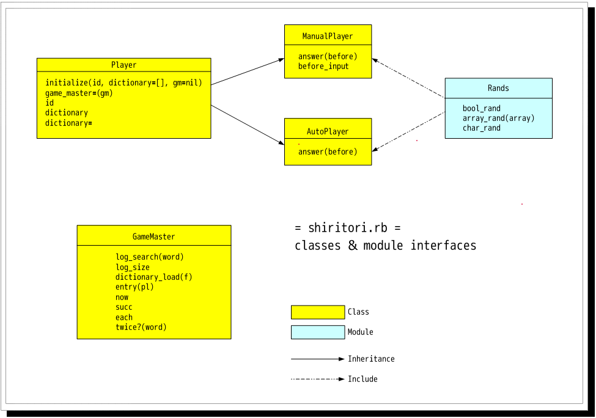

# Rubyコードリーディング:しりとりゲーム {#kfb1075e}

[「プログラミングに詳しい香具師ちょっと来い」](http://dat.vip2ch.com/read.php?dat=01134)の390で提示された要件をRubyで実装したものを説明する。

[要件をまとめた練習問題はこちら](/docs/練習問題)<br />
しりとりゲームの全ソースは以下のリンクをクリックしてダウンロード

<a href="shiritori.rb">shiritori.rb</a>

Ver.3 2007/05/15 構成を修正。ほか細々<br />
Ver.2 2007/05/10 AutoPlayerのバグを修正


# shiritori.rb インタフェース {#k61701e5}
[rdefs.rb](http://jp.rubyist.net/magazine/?c=plugin;plugin=attach_download;p=0013-CodeReview;file_name=rdefs.rb)というスクリプトによって作成。

図はOpenOffice.org Draw。

<div class="pukiwiki-ref"></div>


## Rands {#k1b22987}

```
 module Rands
   def bool_rand
   def array_rand(array)
   def char_rand
```


## GameMaster {#bf2e1bae}

```
 class GameMaster
   def initialize
   def log_search(word)
   def log_size
   def dictionary_load(f)
   def entry(pl)
   def now
   def succ
   def each
   def twice?(word)
 private
   def turn_player
```


## Player {#f6986cc4}

```
 class Player
   def initialize(id, dictionary=[], gm=nil)
   def game_master=(gm)
   attr_reader :id
   attr_accessor :dictionary
```


## ManualPlayer {#qd321ffc}

```
 class ManualPlayer < Player
   include Rands
   def answer(before)
   def before_input
 private
   def read_answer(before, prompt, err_msg)
```


## AutoPlayer {#i723bb6b}

```
 class AutoPlayer < Player
   include Rands
   def answer(before)
 private
   def think_answer(before)
```


# クラス・モジュールごとの解説 {#v0e5dea7}

1. [GameMasterクラス](/docs/プログラミング言語/Ruby/コードリーディング/しりとりゲーム/GameMasterクラス)
1. [Playerクラス](/docs/プログラミング言語/Ruby/コードリーディング/しりとりゲーム/Playerクラス)
1. [ManualPlayerクラス](/docs/プログラミング言語/Ruby/コードリーディング/しりとりゲーム/ManualPlayerクラス)
1. [AutoPlayerクラス](/docs/プログラミング言語/Ruby/コードリーディング/しりとりゲーム/AutoPlayerクラス)
1. [Randsモジュール](/docs/プログラミング言語/Ruby/コードリーディング/しりとりゲーム/Randsモジュール)


# メインフロー(トップレベル)の解説 {#j12a2291}
## リスト6-1 トップレベルの全体像 {#t7da5d41}

```
USAGE = "ruby shiritori.rb DICT_FILE"

begin
  ##(省略)##
rescue RuntimeError => ex
  $stderr.puts "Error: #{ex.message}"
  $stderr.puts "Usage: #{USAGE}"
  exit(1)
end
```


しりとりゲームを処理しているメインの部分は後述する。

外枠のこの処理はそう複雑なものではない。Rubyの例外は最後まで<br />
捕捉されないと、バックトレースを吐いてからプログラムを終了させる。<br />
それはデバックに重宝するのだが、アプリケーションプログラムの終了<br />
としてはちょっと見た目が悪い。そこで例外を捕捉して、エラーメッセージと<br />
使用方法(USAGE)を言ってから、改めて死んでいる。

rescue文では、捕捉する例外クラスを指定しないと自動的にRuntimeError以下の<br />
クラスを捕捉するようにしてくれる。今回省略しなかったのは単に趣味だ。実行時の<br />
エラーだけを捕まえて、重大な例外は自前で異常終了させるぞ、という意思表示である。

ちなみに(名前で判るぞ、と言う方もおられるだろうが)$stderrは標準エラー出力を表す<br />
IOオブシェクトだ。似たようなものに$stdinや$stdoutがある。グローバル変数である。

## リスト6-2 トップレベルのメイン部分(1) {#oecab4e3}

```
 raise "辞書ファイルが指定されていません" if ARGV.empty?
 gm = GameMaster.new
 gm.dictionary_load ARGF
```


Rubyプログラムを起動するときに与えたコマンドライン引数は、<br />
ARGVという定数に、Arrayオブジェクトとして収まっている。

それと名前がよく似たARGFという定数は、少々特殊な擬似的なIOオブジェクトだ。<br />
(擬似的とは … p ARGF.class #=> Object)

ARGFはUnixのフィルタプログラムを作成する際に理想的な機能を備えている。<br />
即ち、コマンドライン引数があればそれをファイル名としてオープンしていき、<br />
引数がなければ標準入力を読む。ARGFの場合、いくら引数があっても、<br />
ひとつの連続したファイルを開いているかのように扱える。

しかし、このコードではその便利な特性を一つ潰してしまっている。<br />
Array#empty?でARGVが空かどうかを事前にチェックしているからだ。<br />
ただ、このプログラムで、標準入力を使う必要性があまり感じられなかった<br />
のでこういう措置を取った。sedかなにかで加工した辞書データを直接<br />
流し入れたいという人は我慢して一旦ファイルにリダイレクトしてほしい。


## リスト6-3 トップレベルのメイン部分(2) {#g2bddd32}

```
 pls = [ManualPlayer.new("あなた"), AutoPlayer.new("わたし")]
 pls.reverse! if Rands.bool_rand
 pls.each{|x| gm.entry x}
```


少し見づらいかもしれないが、plsに代入しているのは<br />
リテラルで生成された配列だ。中身は見てのとおりである。

Array#reverse!は配列の順番を逆転させる。Array#reverseと違うのは、<br />
前者は呼び出し元のオブジェクトを直接操作する(破壊的操作)が、<br />
後者はその操作が施された新しいオブジェクトが生成されて返されるところである。

Rands.bool_randは半々の確率で真偽どちらかを返す。つまり


```
 ... if Rands.bool_rand
```


は、「50%の確率で...を実行する」と読める。<br />
その後、順番にGameMasterにentryされているので、<br />
これはプレイヤーとコンピュータの先攻後攻をランダムで決定しているのだ。

## リスト6-4 トップレベルのメイン部分(3) {#j5615b0d}

```
 word = nil
 gm.each do |word|
   $stderr.puts "#{gm.now.id}の回答 ... #{word}"
 end
```


ここがしりとり勝負のループだ。wordにnilを代入しているのは、<br />
しつこく言うが、Rubyのブロックローカルスコープ対策である。


## リスト6-5 トップレベルのメイン部分(4) {#n8fac67e}

```
 if gm.now.id == "あなた"  #now.id ... Looser
   log = gm.log_search(gm.now.before_input)
   $stderr.print "「その言葉は #{log[0]} 回目に #{log[1]} が使用しています。"
   $stderr.puts "わたしの勝ちです。"
 else
   $stderr.puts "「まいりました！あなたの勝ちです。"
 end
 $stderr.puts "　今回のしりとりでは #{gm.log_size} 個の単語を使用しました。」"
```


GameMaster#nowはループの外では直前の回答者を返す。故に、決着直後の<br />
「直前の回答者」はつまり「敗者」のことだ。

要件によれば、プレイヤーの負けかコンピュータの負けかで通知することが違うので、<br />
GameMaster#entryするときに設定したidで分岐している。

プレイヤーが負けの場合、敗因の回答であるbefore_inputを<br />
log_searchにかけて、必要な情報を得ている。

# おわりに {#s8e5a4c6}
以上、長々とひとつのプログラムを解説してきた。

正直このプログラムには反省点も多々ある。<br />
例えばGameMaster#nowなどである。<br />
が、そのへんの改良は皆さんへの課題としておく。<br />
とか言って都合よく締めておきたい。

また、人にモノを教える文章など書く機会がないので、<br />
「ここわかりづれーよ」と思ったらスレがどこかで吐き捨てて欲しい。<br />
確実に改善できる保証はないが、可能な限り善処する。
