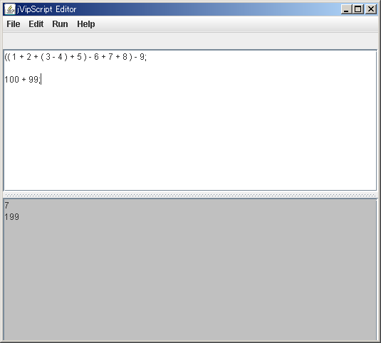
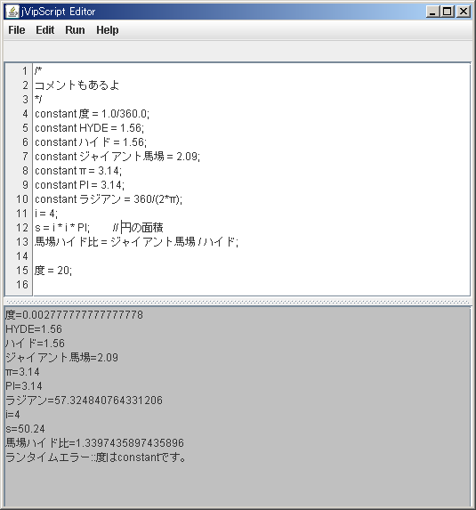

# j&#86;ipScript(仮) {#r362f780}
## これはなに？ {#w4a4f0f8}
これは超初心者専用プログラミング勧誘用簡易スクリプト言語です。スレにてプロジェクトページを作ってもいいとお許しを得ましたので書かさせて頂きます。名称も募集、コメントも募集

## 動機 {#de930a1f}
ニートにも夢を与えたい。プログラミングの楽しさを伝えたい。来年の課題をいまからしてしまおうという不純な動機からです。

## 特徴 {#tb9b8581}

<dl>
  <dt>インストールが不要</dt>
  <dd>javaアプレットで実装されているのでインストールする必要がありません。気軽に試すことができます。</dd>
  <dt>世界初ゆとり仕様の導入</dt>
  <dd>情報はすべて日本語で提供されます。ラジアンだけでなく度も使うことができます。また円周率は3です。</dd>
  <dt>１日で使い捨てインスタント言語</dt>
  <dd>ものの数時間で捨てられる言語を目指します。ちょっと遊べればいいじゃん</dd>
</dl>


## 今考えていること {#s36eac70}

- Cライクにして次に繋げやすくするか、BASICライクして超簡単にするか
- サンプルをいっぱい用意してそれを改造する形で遊んでもらうことを考えてる。
- そういえばアプレットにしたらファイル保存できないよねぇ まぁ保存するような言語ではないからいいとするか


## 当面の目標 {#t44503e3}
テストをがんばる

## コメントどうぞ {#p9774ced}

- 2007-07-03 (火) 16:16:28 名無しさん : ニートにプログラミングの楽しさを伝えるにはHSP以下の難易度が必須事項だろ...
- 2007-07-03 (火) 22:30:28 名無しさん : さすがにやりすぎだと思いますｗｗｗ＞円周率は3です。
- 2007-07-04 (水) 00:35:49 名無しさん : HelloWorkは駄目だろw
- 2007-07-04 (水) 00:59:53 名無しさん : HelloWorkｗｗｗｗｗｗｗｗｗｗｗｗｗｗ
- 2007-07-05 (木) 01:06:07 名無しさん : 簡単にするならmain()関数は不要。ベタ書きで動くべき
- 2007-07-05 (木) 03:58:47 名無しさん : ＊べた書き　＊データ型は暗黙
- 2007-07-05 (木) 16:19:49 名無しさん : JavascriptとVB.netの合いの子みたいにしろ
- 言語にはsyntaxとsemanticsがあるます．コンパイラはsyntaxでsemanticsは暗黙にi386とか仮想機械になってる落ち --  2008-06-22 (日) 19:31:51
- アプレットもjar署名付ければローカルにアクセスできるよ。 --  2008-07-14 (月) 16:03:49
- データ型は暗黙、関数に戻り値・引数はなし、グローバル・ローカルの区別なし --  2008-07-22 (火) 22:33:12
- カタカナ語がでない言語 --  2008-08-06 (水) 23:56:52
- 予約語をもっとわかりやすく、識別しやすく --  2008-09-01 (月) 22:46:58
- 変数名の頭に$が付いてたら見やすくね？ --  2008-09-01 (月) 22:49:24
- 三は酷いｗｗｗｗｗｗｗｗｗ --  2009-02-23 (月) 18:48:44
- 前後にアンダーバーを2個ずつ付けるんですね、わかります。＞予約語をもっとわかりやすく、識別しやすく --  2009-03-09 (月) 10:15:16


業者いいかげんにしろお（＃＾ω＾）ﾋﾞｷﾋﾞｷ

コメント欄をコメントアウトしてみた。ので手動で編集してNE（＊＾ω＾）

# 仕様 {#f2000731}
## 概要 {#jc666f3e}

<dl>
  <dt>手続き型言語</dt>
  <dd></dd>
  <dt>変数暗黙宣言</dt>
  <dd>とくに宣言しなくても使えます。数字や文字なんでもつっこめます。細部は未定</dd>
  <dt>Cライクな書き方</dt>
  <dd>{}で区切ります。</dd>
  <dt>代入演算子<-の導入</dt>
  <dd>僕は混乱とかしたことないですがx=x+1とかは理解しにくいのでしょうか</dd>
  <dt>画期的な定数の採用</dt>
  <dd>PI = 3,HYDE = 1.56,EXP=3</dd>
  <dt>文末に;</dt>
  <dd>必要ないですかね</dd>
</dl>


## 構文 {#a3466128}

- if()〜else
- for(From i=0 To 100 Step 1){}


## サポートされる関数 {#c9bdaecd}

<dl>
  <dt>print()</dt>
  <dd>出力します。</dd>
  <dt>input()</dt>
  <dd>入力します。</dd>
  <dt>getTime()</dt>
  <dd>時間を取得します １秒単位です ニートに精度は必要ないでしょ？</dd>
</dl>


# 実際のコード {#md40b54b}
## HelloWorld {#h5a773a7}

```
print("HelloWork!");
```


## うるう年判定 {#j951a965}

```
print("西暦 = ");
y <- input();
```


```
if((y % 4=0) AND (y % 100 not 0) OR (y % 400 = 0)){
    print(y + "年は閏年です");
}else{
    print(y + "年は閏年ではありませぬ");
}
```


## 円の面積 {#k4fe01c1}

```
print("半径を入力してください");
radius <- input();
```


```
//円の面積の公式は半径×半径×3です
print("円の面積は" + radius * radius * PI + "です");
```


---

データ型はJSみたいに暗黙宣言を基本にしたほうが簡単だろ
　-採用する方向で検討します。

# 進捗日記 {#z4ae18cf}
## 7月4日 {#i63e9240}
コンパイラの設計と構築という本を読んだ。まだ俺には早いようだ。

## 7月5日 {#lc30101f}
ネットを漁った　学校の図書館にはいい本があまりない。貧乏大学はつらい

成果

- [数値計算インタプリタを作ろう](http://www.oishi.info.waseda.ac.jp/~oishi/interpreter/interpreter.htm)
- [プログラミング言語を作る](http://kmaebashi.com/programmer/devlang/index.html)
- [プログラム言語を作る!-ITpro](http://itpro.nikkeibp.co.jp/article/COLUMN/20060922/248698/?ST=develop)


鬱病なのでやる気出ません。とりあえず１＋１ができれば満足かな
# スクショ {#paf1bc91}
元の作者が居ないんで勝手に引継ぎました。
足し算引き算までおｋ


---

2008-10-0217:02:33<br />
const的なのとか。構文は大体完成したけど実装はまだ



---

4

かゆい

うま
